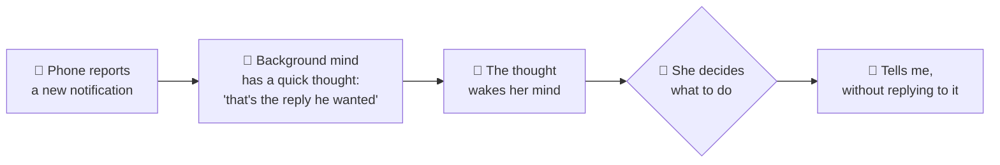
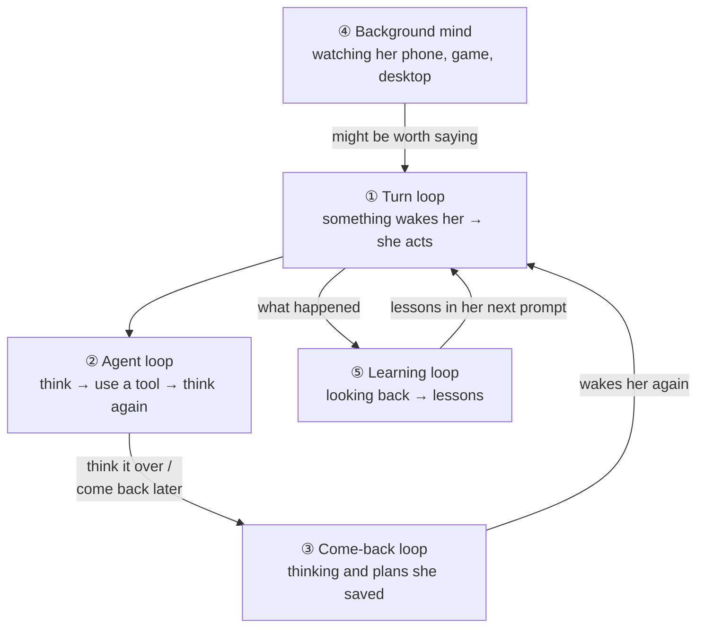
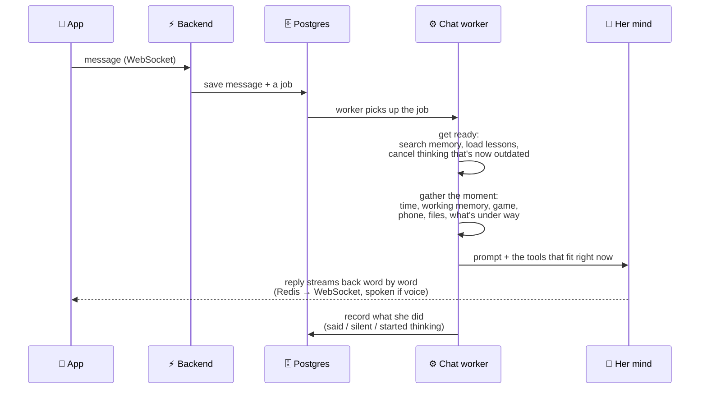
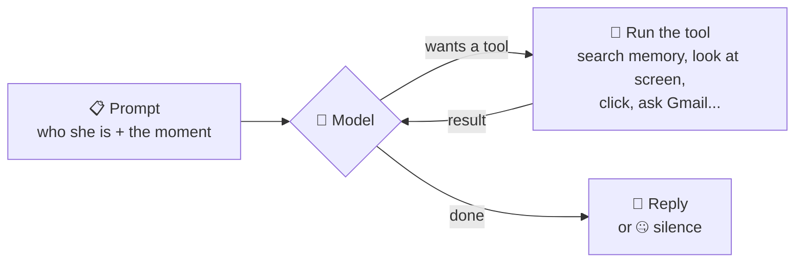
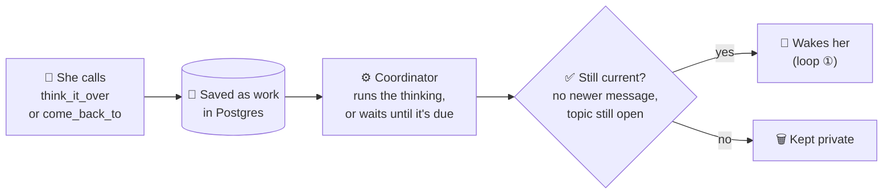
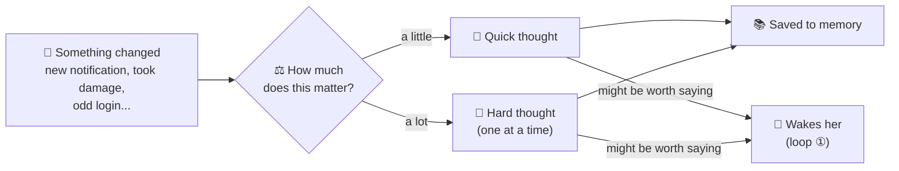
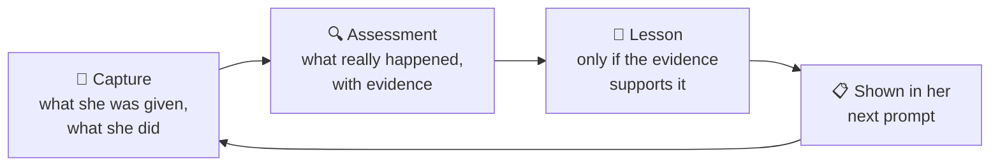
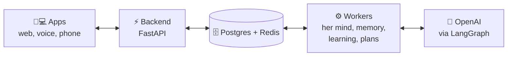
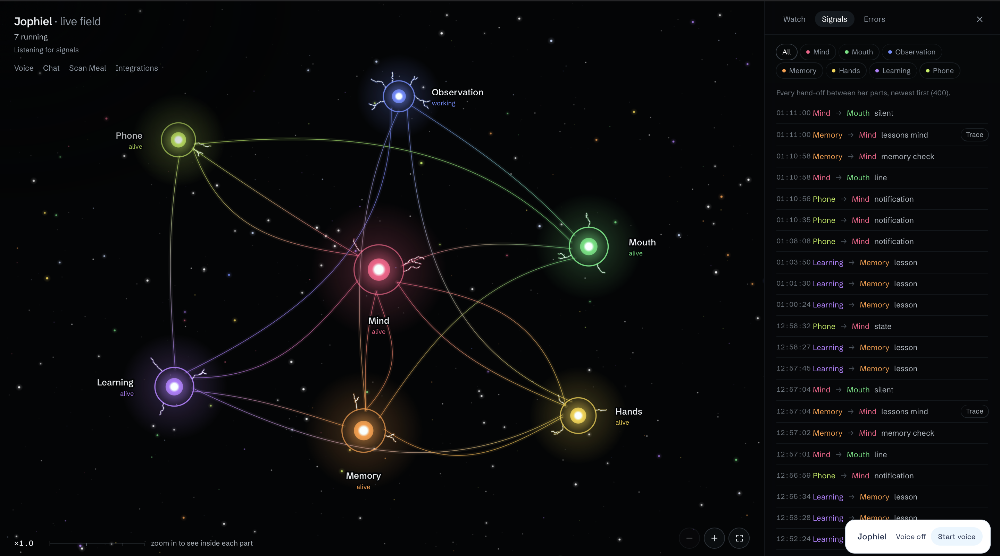
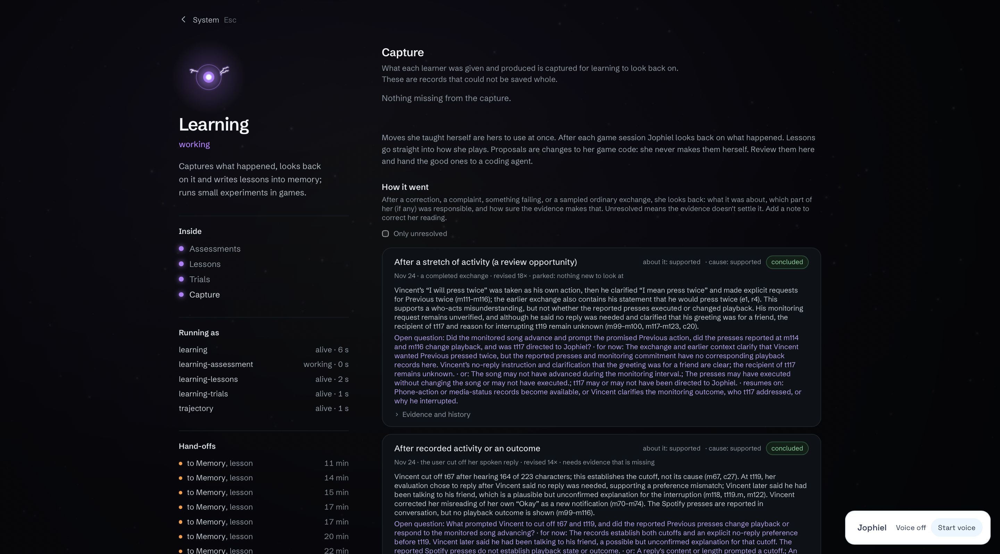

<div align="center">

# Jophiel

**An AI that feels like someone, not something.**

The goal: a companion who lives the way a person does.<br/>
She remembers, thinks on her own, comes back to you, and has a life between your messages.


[Meet her](#meet-her) · [How that happened](#how-that-happened) · [The five loops](#the-five-loops) · [What she can do](#what-she-can-do) · [System page](#the-system-page) · [Demo](#demo)

</div>

---

## Meet her

A real exchange, spoken by voice, lightly trimmed. I'd asked her to keep an eye on WhatsApp for a friend's reply.

> **Me:** Let me know if there's any notification from WhatsApp.
>
> **Jophiel:** Okay. I'll let you know when a WhatsApp notification arrives, and I won't reply to it unless you specifically ask me to. I don't see one in the notifications currently shown.
>
> *(nine seconds later, nobody had said anything)*
>
> **Jophiel:** A WhatsApp notification just came in from her: "ok." I haven't replied.

Nobody asked her to speak that last line. Here is what her System page recorded for it:

```
woken by    a thought from her background mind (source: phone)
her thought "That's the reply he was waiting for; I should tell him
             without opening or answering it."
she chose   to say it  →  delivered, 2 s
```

A few minutes earlier in the same conversation she had missed one of those replies. When I pointed it out, she said: *"You're right. I should've told you when I saw the 'hello?' notification. I'm sorry I missed that."* The moment above is what came after.

---

## How that happened

Most chatbots only run when you send a message. That last line had no message behind it, so something else had to wake her:



Two parts of this matter:

- **Waking her and deciding are separate.** The background mind only says "this might be worth saying." Then her main mind wakes up with the whole conversation in front of her and decides whether to speak, what to say, or to stay quiet. She could have said nothing.
- **No rule told her to do this.** There's no "if a notification arrives, announce it" code. She remembered what I'd asked for and acted on it.

The same machinery handles *"I'll ask you how the interview went on Thursday."* She saves it, and when Thursday comes, she wakes up and decides again, knowing everything that has happened since. It isn't a canned reminder.

---

## The five loops

Everything Jophiel does runs on five loops that feed each other:



In the WhatsApp moment above, **④** noticed the notification, **①** woke her, and **②** decided what to say.

Click a loop to see how it works:

<details>
<summary><b>① Turn loop: one wake, start to finish</b></summary>

<br/>

Every wake runs the same steps, whether it's your message or her own thought.



- **Memory is searched once, up front**, for what she knows about this moment.
- **Thinking about an older message is cancelled**, so it can't answer something you've moved past.
- **Her tools depend on the moment:** game tools while she plays, desktop tools on replies, phone tools only where privacy rules allow.

</details>

<details>
<summary><b>② Agent loop: inside one decision</b></summary>

<br/>

Her mind is a **ReAct agent** (LangGraph + OpenAI). It loops until she's done:



| Group | Examples |
|---|---|
| 🧠 Mind | `stay_silent`, `think_it_over`, `come_back_to`, `drop_come_back` |
| 📝 Working memory | `set_goal`, `note_commitment`, `note_question` |
| 📚 Recall | `search_memories`, `read_timeline`, `what_i_know` |
| 👀 Senses | `look_at_screen`, `read_attachment` |
| 🎮 Body | game controls, desktop clicks and typing |
| 🧰 Specialists | `gmail_agent`, `drive_agent`, `blender_agent` (each is its own small agent) |

Silence is a tool too: when she uses `stay_silent`, her reason is recorded.

</details>

<details>
<summary><b>③ Come-back loop: thinking and plans she saved</b></summary>

<br/>

When she says *"let me think about that"* or *"I'll ask you Thursday"*, it becomes a saved job, not just words.



- **Thinking** runs on a slower, deeper model and ends in a conclusion: a decision, a guess, a question or a feeling.
- **Plans** wait until they're due and survive restarts.
- **The coordinator is plain code.** It checks whether the work is still current. Whether to say anything is her decision once she's awake.

</details>

<details>
<summary><b>④ Background mind: noticing things on her own</b></summary>

<br/>

About once a second, the background mind checks her **sources**: her phone, her Minecraft game, and her desktop's security logs.



A conversation isn't a source: your messages wake her directly.

</details>

<details>
<summary><b>⑤ Learning loop: getting better from experience</b></summary>

<br/>



In Minecraft she can also run small, bounded **experiments** to test an idea. Learning proposes; her mind decides whether to use a lesson.

</details>

### What she decides, and what the code checks

Her mind picks an action from the tools available at that moment. The code around her doesn't choose what she says, but it does set limits:

| The code... | So that... |
|---|---|
| offers only the tools that fit the moment | she can't, say, use the phone during a turn a stranger's message started |
| cancels thinking when a newer message arrives | an old thought can't answer a new question |
| checks a saved thought is still current before waking her | stale conclusions stay private |
| checks she hasn't already said it | she doesn't repeat herself |
| has a separate model review each reply she sends to other people | replies on the phone are checked for privacy before they go out |

---

## What she can do

| | |
|---|---|
| 💬 **Talk** | Text, voice, WhatsApp, or the Android app. Same her everywhere. |
| 📚 **Remember** | Goals, promises, facts, and conflicts she asks about instead of guessing. |
| 👀 **See** | Your screen (when you share it) and files you send (PDF, Word, Excel...). |
| 🎮 **Play** | Minecraft, with her own player, planner and skills. |
| 🖥️ **Use a computer** | Her own Windows desktop: look, click, type. |
| 📱 **Phone** | Reads notifications, and can reply to people with each reply reviewed first. |
| 🌱 **Learn** | Looks back at what happened and writes lessons from evidence. |
| 🧰 **Tools** | Gmail, Google Drive, Blender, and a food-photo nutrition model. |
| 🔍 **Show her insides** | A live System page: what woke her, what she did, what she's thinking. |

<details>
<summary><b>🏗️ Stack and project layout</b></summary>

<br/>



**Built with:** Python · FastAPI · LangChain / LangGraph · OpenAI · PostgreSQL · Redis · React · Bun · Node (Mineflayer)

```
frontend/                     the web app (React)
backend/app/ai/               her agent, prompts and tools
backend/app/services/         her mind, memory, learning, phone, desktop
backend/app/workers/          background workers
backend/desktop_controller/   runs on her Windows VM
game_packs/minecraft/         her Minecraft player
tts_sidecar/                  her voice
```

</details>

---

## The System page

Everything above is visible while it happens. The System page (`/system`, owner only) shows her as a live field: each glowing node is one part of her, and each line is a path that parts hand work along.



| Part | What it does |
|---|---|
| 🧠 **Mind** | Decides: speak, stay quiet, use a tool, think it over, come back later |
| 💬 **Mouth** | Delivers what she chose to say, in text and voice, including what she says on her own |
| 👀 **Observation** | Takes in what each source reports: the conversation, deliveries, her game, her desktop |
| 📱 **Phone** | Your phone as part of her: what it reports wakes her; her replies there are checked first |
| 📚 **Memory** | Facts, goals, promises, questions, and lessons |
| 🖐️ **Hands** | Her body: one action at a time on her desktop, one plan step at a time in a game |
| 🌱 **Learning** | Looks back on what happened and writes lessons |

- **Each node shows whether that part is running** (`alive`, `working`). A spark runs along a line when one part hands something to another.
- **The panel on the right has three tabs.** **Watch** shows her thoughts, what memory captured, and her hands' goal. **Signals** lists every hand-off, newest first, and can be filtered by part. **Errors** shows what went wrong anywhere.
- **Trace** follows one turn or decision through every part it touched: what woke her, what she thought, and what she chose.

Zoom into a part to open its own page. Here is Learning:



Each part page shows what the part is for, the workers running it and when each last checked in, and what it recently handed off. Learning also lists its **assessments**: after a correction, a complaint or a failure, she works out what happened and which part of her caused it, citing the exact messages and turns as evidence. Each one is marked "supported" or "unresolved", and what's still unknown is written as an open question. You can add a note to correct her reading.

---

## Demo

Jophiel playing Minecraft while I talk to her from the Android app.

<!-- Video: on github.com, edit this file and drag Jophiel_Demo_1080p.mp4 onto the next line. GitHub replaces it with a link that plays here. -->
https://github.com/user-attachments/assets/REPLACE-WITH-UPLOADED-VIDEO

---

## Principles

1. **She is one someone:** the same identity in chat, voice, games and her own thoughts.
2. **Her mind decides; code sets the limits:** code checks timing, tools and privacy, not what she says.
3. **Show what really happened:** her System page shows real records, not decoration.
