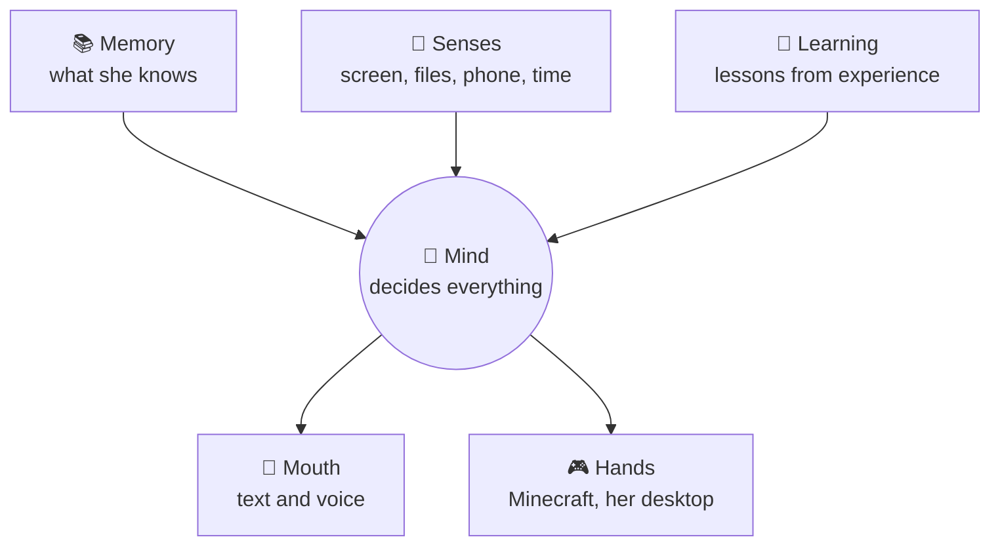
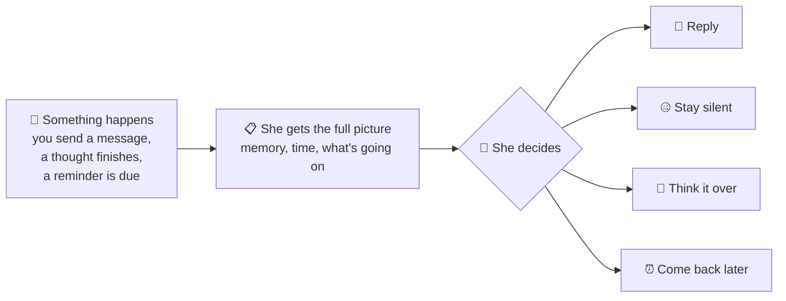
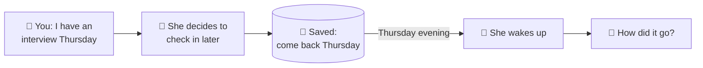
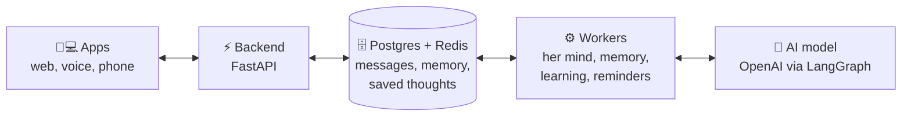

<div align="center">

# Jophiel

**An AI companion with a mind of her own.**

She remembers you, keeps thinking after you stop typing,<br/>
comes back to things on her own, and plays Minecraft beside you.


[What is it](#what-is-jophiel) · [How she works](#how-she-works) · [What she can do](#what-she-can-do) · [Run it](#run-it-locally)

</div>

<!-- Demo: replace with a GIF or video link, e.g.  -->

---

## What is Jophiel?

Most chatbots only exist while you're talking to them. You send a message, they answer, they forget.

Jophiel is different:

- 🧠 **She keeps thinking.** She can mull something over in the background and get back to you.
- ⏰ **She comes back on her own.** *"How did the interview go?"* without you asking.
- 🤐 **She can choose to say nothing.** Not every message needs a reply.
- 📚 **She remembers.** Facts, your goals, what she promised, and what she's unsure about.
- 🎮 **She has a body.** She plays Minecraft as her own player and can use her own computer.

---

## How she works

### 1. She is made of parts

Like a person, she has parts that each do one job. **The mind is the only one that decides.**



### 2. Every moment is one decision

Something wakes her up. She looks at the situation. She picks what to do.



Nothing filters her choice. No rule says when to speak or what to talk about. **She decides; the code only makes sure it's still the right moment** (for example, that you haven't already moved on).

### 3. She lives between messages

Thinking and reminders are saved to the database, so they survive restarts. When they finish, they wake her again.



---

## What she can do

| | |
|---|---|
| 💬 **Talk** | Text, voice, WhatsApp, or the Android app. Same her everywhere. |
| 📚 **Remember** | Goals, promises, facts, and conflicts she asks about instead of guessing. |
| 👀 **See** | Your screen (when you share it) and files you send (PDF, Word, Excel...). |
| 🎮 **Play** | Minecraft, with her own player, planner and skills. |
| 🖥️ **Use a computer** | Her own Windows desktop: look, click, type. |
| 📱 **Phone** | Reads notifications and can reply to people, with a privacy check on every message. |
| 🌱 **Learn** | Looks back at what happened and writes lessons from real evidence. |
| 🧰 **Tools** | Gmail, Google Drive, Blender, and a food-photo nutrition model. |
| 🔍 **Show her insides** | A live System page: what woke her, what she did, what she's thinking. |

---

## Under the hood



- **Her mind** is one AI agent (LangGraph + OpenAI) that runs every time she wakes up.
- **Her tools** change with the moment: game tools only while she plays, phone tools only when it's safe.
- **Postgres** holds everything that matters, so nothing she planned is lost on restart.
- **Workers** run in the background: her thinking, memory, learning and reminders.

**Built with:** Python · FastAPI · LangChain / LangGraph · OpenAI · PostgreSQL · Redis · React · Bun · Node (Mineflayer)

<details>
<summary><b>📁 Project layout</b></summary>

```
frontend/                     the web app (React)
backend/app/ai/               her agent, prompts and tools
backend/app/services/         her mind, memory, learning, phone, desktop
backend/app/workers/          background workers
backend/desktop_controller/   runs on her Windows VM
game_packs/minecraft/         her Minecraft player
tts_sidecar/                  her voice
```

</details>

---

## Run it locally

```bash
# 1. Database
docker compose up -d db
cd backend && uv sync && uv run alembic upgrade head

# 2. Backend (put OPENAI_API_KEY in backend/.env)
uv run uvicorn app.main:app --reload
uv run python -m app.workers

# 3. Frontend
cd frontend && bun install && bun run dev
```

Then open http://localhost:5173 and say hi.

---

## Principles

1. **She is one someone:** the same identity in chat, voice, games and her own thoughts.
2. **Her mind decides; code keeps it safe:** code checks timing and privacy, never what she says.
3. **Show what really happened:** her System page shows real records, not decoration.
