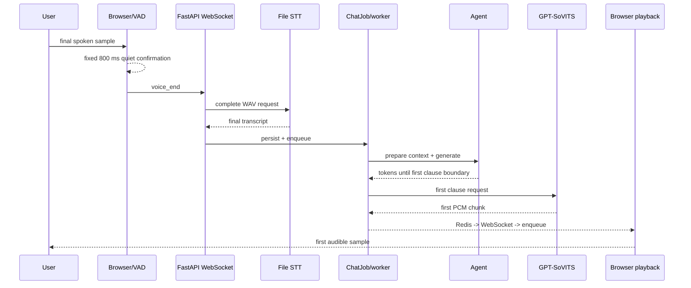
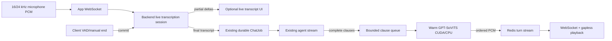
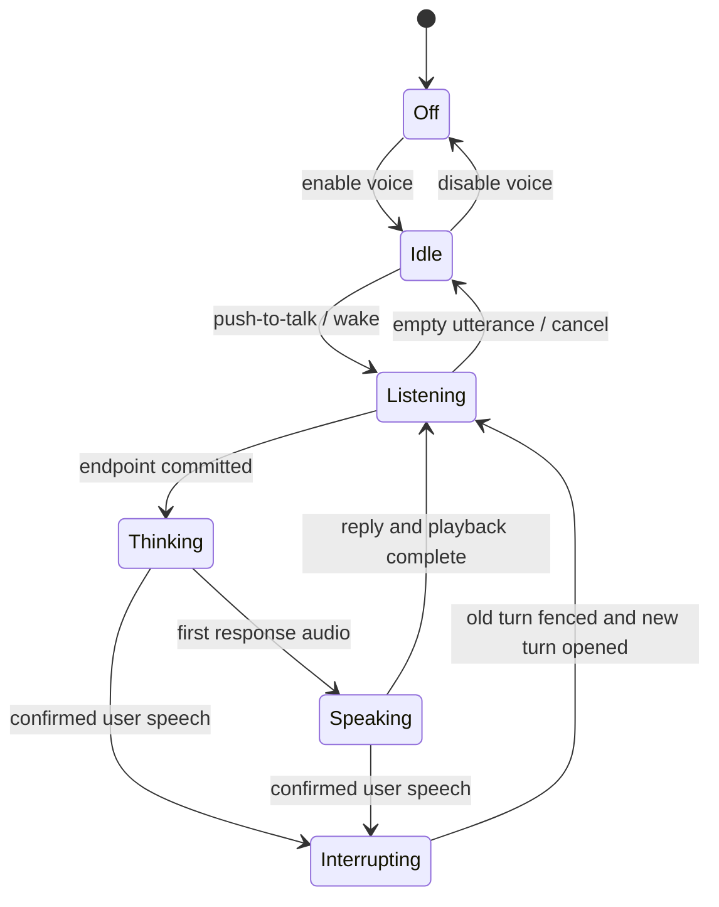

# Voice Latency Improvement Implementation Guide

Status: implementation plan only. This document does not change runtime behavior.

## 1. Executive summary

The target is a **fully streaming chained voice pipeline** that preserves the
custom Columbina GPT-SoVITS voice:

1. OpenAI live transcription processes microphone audio while the user speaks.
2. The existing Columbina agent, memory, tools, and durable ChatJob worker
   produce the response.
3. GPT-SoVITS synthesizes short, ordered clauses through the existing custom
   voice sidecar.
4. Browser playback begins as soon as the first playable PCM frame arrives.

Do not replace the custom output voice with OpenAI speech-to-speech. OpenAI
Realtime is useful here as a design reference, and OpenAI live transcription
is useful as the streaming input stage, but output remains GPT-SoVITS.

The reported user-visible problem is approximately 8-10 seconds from the end
of speech to the first audible response. Optimize and report **time to first
audible audio**, not only total turn duration. The first implementation PR must
establish a trustworthy baseline before changing several variables at once.

Recommended order:

1. End-to-end observability and a repeatable baseline.
2. Live transcription with fallback to the existing file transcription path.
3. Production-worker producer/consumer TTS queue.
4. Earlier, complete first speech phrase.
5. CUDA and guarded half-precision optimization.
6. Conservative VAD tuning, followed by optional adaptive endpointing.
7. Initial GPT-SoVITS stream-chunk tuning.
8. Optional pre-rendered acknowledgements as perceived-latency polish.

## 2. Goals, non-goals, and constraints

### Goals

- Reduce p50 and p95 time from the user's final speech to first audible audio.
- Preserve the custom Columbina voice and existing agent/tool behavior.
- Overlap stages when correctness permits instead of serializing them.
- Preserve cancellation, barge-in, reconnect recovery, durable jobs, and
  conversation persistence.
- Make every improvement measurable and independently reversible.
- Degrade safely to the current transcription/TTS behavior on provider or GPU
  failure.

### Non-goals

- Replacing GPT-SoVITS output with a built-in Realtime voice.
- Starting the agent from unstable partial transcript text.
- Claiming that silence alone can perfectly identify user intent.
- Hiding all latency with filler speech and calling it solved.
- Changing the wake-word implementation.
- Reworking the agent, cognitive system, memory semantics, or tool policies.

### Constraints and invariants

- OpenAI API keys remain on the backend.
- The final transcript, not an unstable partial, is the persisted user message
  and input to the existing ChatJob.
- Audio and transcript events must remain scoped by `turn_id`; live
  transcription also needs its provider `item_id` mapping.
- A cancelled or superseded turn must not emit late transcript, text, or audio.
- `audio_start`, ordered audio payloads, and `audio_end` must remain coherent.
- The worker lease and claim token remain authoritative for durable generation.
- Each phase ships behind configuration and has an immediate rollback path.

## 3. Current implementation: verified trace

### 3.1 Browser capture and endpointing

- `frontend/src/audio/capture.ts`
  - `CAPTURE_SAMPLE_RATE = 16000`.
  - `startCapture()` obtains mono microphone audio with echo cancellation,
    noise suppression, and automatic gain control.
  - `/audio/pcm-worklet.js` emits signed 16-bit PCM and RMS frames.
- `frontend/src/audio/vad.ts`
  - `createVad()` is energy based.
  - `DEFAULT_VAD.hangoverMs` is 800 ms.
  - It emits `speech-start` after the minimum onset and `speech-end` after the
    fixed quiet hangover.
- `frontend/src/hooks/useVoiceSession.ts`
  - `handleFrame()` sends PCM continuously while state is `listening`.
  - `handleVad('speech-end')` calls `finishUtterance()`.
  - `endTurn()` is the explicit manual endpoint and must remain available.
- `frontend/src/hooks/useChatSocket.ts`
  - `startVoice()` sends `voice_start` with conversation, turn, and sample rate.
  - `sendAudio()` sends each PCM frame as a binary WebSocket message.
  - `endVoice()` sends `voice_end`.

Important distinction: microphone audio already travels incrementally from the
browser, but it is not currently transcribed incrementally.

### 3.2 Backend buffering and transcription

- `backend/app/api/routes/chat.py`
  - An in-memory `utterance: bytearray` opens on `VoiceStartRequest`.
  - Every binary audio frame is appended to that bytearray.
  - `VoiceEndRequest` freezes the bytes and starts `run_voice_turn()`.
  - `run_voice_turn()` calls `stt_service.transcribe(pcm, sample_rate)` only
    after the entire utterance has ended.
  - It then persists the final transcript, enqueues a durable ChatJob, sends
    `ack`, and subscribes to the job's Redis event stream.
- `backend/app/services/stt.py`
  - `transcribe()` wraps raw PCM in WAV and calls the file transcription API.
  - `stt_model` defaults to `gpt-4o-mini-transcribe` (switched from `whisper-1`
    for speed) in `backend/app/core/config.py`.

This means VAD confirmation and complete-file transcription are sequential.

### 3.3 Durable generation and TTS

- `backend/app/workers/chat.py::_generate()`
  - Claims the job, loads conversation/user/tool context, and streams agent
    events.
  - Feeds model tokens into `tts_service.clause_chunker()`.
  - For each emitted clause it enters `tts_service.synthesize()` inline and
    publishes PCM before returning to consume more model tokens.
  - Production voice therefore does **not** currently overlap continued model
    token consumption with synthesis of the emitted clause.
- `backend/app/api/routes/chat.py::speak()`
  - The local/direct path and nudges already demonstrate an `asyncio.Queue`
    consumer that runs beside generation. Treat this as a behavioral reference,
    not code to copy blindly; the durable worker has lease, Redis, retry, and
    cancellation obligations the local path does not.
- `backend/app/services/tts.py`
  - `clause_chunker()` splits on punctuation.
  - `_MIN_CLAUSE_CHARS = 12`; `_MAX_CLAUSE_CHARS = 96`.
  - `synthesize()` streams raw, sample-aligned PCM from the sidecar.
  - Existing comments and benchmarks put CPU time to first TTS chunk around
    1.9 seconds.
- `tts_sidecar/engine.py`
  - Startup calls `warm()` and caches fixed reference conditioning.
  - `STREAM_MIN_CHUNK_LENGTH` defaults to 8.
  - `TTS_Config` currently sets `is_half: False` for every device.
  - v1 fine-tune, v2Pro, and v4 modes are selectable.
- `frontend/src/audio/playback.ts`
  - Received PCM is scheduled against a running Web Audio cursor for gapless
    playback.

### 3.4 Current latency waterfall



Streaming output prevents waiting for the full response, but it cannot begin
until the first clause exists and GPT-SoVITS produces its first PCM.

## 4. Target architecture



Partial transcript text is observational until commit. Only the provider's
completed transcript starts the durable agent turn.

## 5. Phase 0: observability and reproducible baseline

### 5.1 Timestamp vocabulary

Use a monotonic clock for durations inside one process and include UTC wall
time only for cross-process correlation. Emit one structured event schema with:

- `event`: stable name such as `voice_latency_mark`.
- `stage`: mark name below.
- `turn_id`, `conversation_id`, `user_id_hash` (never raw user content).
- `chat_job_id`, `job_attempt`, and `claim_token_hash` when available.
- `transcription_session_id` and `transcription_item_id` when available.
- `monotonic_ms`, `wall_time`, `duration_from_origin_ms`.
- Safe dimensions: sample rate, audio duration, byte count, clause character
  count, TTS mode/device/precision, model aliases, feature-flag variants.
- Never log raw audio, transcript content, prompts, API keys, or full claim
  tokens.

Required marks:

| Mark | Owner/location | Meaning |
|---|---|---|
| `speech_last_active` | `useVoiceSession.ts` / `vad.ts` | Last frame classified as speech |
| `vad_endpoint` | `useVoiceSession.ts` | VAD emitted speech-end |
| `voice_end_sent` | `useChatSocket.ts` | Client sent the endpoint control frame |
| `voice_end_received` | `chat.py` | Server received endpoint |
| `live_stt_ready` | future streaming STT service | Provider session configured |
| `stt_first_partial` | future streaming STT service | First transcript delta |
| `stt_commit_sent` | future streaming STT service | Audio buffer commit sent |
| `stt_final` | `chat.py` / STT service | Final transcript accepted |
| `job_enqueued` | `chat.py` / chat service | Durable job committed |
| `job_claimed` | `workers/chat.py` | Worker obtained lease |
| `agent_context_ready` | `workers/chat.py` | History, memory, integrations, runtime context ready |
| `model_first_token` | `workers/chat.py` | First visible model token |
| `first_clause_emitted` | `workers/chat.py` / chunker wrapper | First TTS-safe clause queued |
| `tts_request_started` | `services/tts.py` | HTTP request to sidecar begins |
| `tts_first_byte` | `services/tts.py` | First aligned PCM bytes received |
| `redis_first_audio` | `workers/chat.py` | First audio payload published |
| `ws_first_audio` | `chat.py::subscribe_turn` | First audio payload sent to browser |
| `browser_audio_enqueued` | `useVoiceSession.ts` / `playback.ts` | First PCM scheduled |
| `browser_playback_started` | `playback.ts` | AudioContext source actually starts |

For cross-process durations, use wall-clock timestamps from synchronized hosts
or propagate accumulated upstream durations in event metadata. Do not subtract
unrelated monotonic clocks.

### 5.2 Derived metrics

- Endpoint delay: `vad_endpoint - speech_last_active`.
- Network/control delay: `voice_end_received - voice_end_sent`.
- Finalization delay: `stt_final - stt_commit_sent`.
- Current file STT delay: `stt_final - voice_end_received`.
- Queue delay: `job_claimed - job_enqueued`.
- Context preparation: `agent_context_ready - job_claimed`.
- Model TTFT: `model_first_token - agent_context_ready`.
- Clause formation: `first_clause_emitted - model_first_token`.
- TTS TTFA: `tts_first_byte - tts_request_started`.
- Delivery delay: `browser_audio_enqueued - redis_first_audio`.
- Playback scheduling delay: `browser_playback_started - browser_audio_enqueued`.
- Primary KPI: `browser_playback_started - speech_last_active`.
- Secondary KPI after explicit manual end: `browser_playback_started - voice_end_sent`.

### 5.3 Baseline protocol

Use a fixed corpus of short questions, long questions, hesitations, numbers,
names, quiet rooms, background noise, and deliberate mid-sentence pauses.
Record at least enough repetitions to report p50 and p95 without presenting a
single lucky run as representative. Keep microphone, machine, network, models,
prompt, and TTS mode fixed while changing one factor. Record empty turns,
false endpoints, provider failures, cancellations, and audio underruns as
separate correctness metrics.

### 5.4 First PR scope

The recommended first PR adds the mark schema, server/worker/client marks, a
small aggregation script or documented query, and a reproducible fixture/run
protocol. It must not also change VAD, STT provider, chunk sizes, or GPU mode.

Acceptance:

- One `turn_id` traces from microphone endpoint through actual playback.
- Every production voice turn reports the primary KPI or an explicit terminal
  reason explaining why it cannot.
- p50/p95 can be computed by stage and total.
- Logging contains no raw transcript or audio.

## 6. Phase 1: live transcription while the user speaks

Official reference: [OpenAI Realtime transcription](https://developers.openai.com/api/docs/guides/realtime-transcription).

Current official guidance recommends `gpt-live-transcribe` for transcript
deltas as speech arrives. Its transcription session uses client-side
endpointing: append audio continuously and send `input_audio_buffer.commit` at
the end. Do **not** configure `server_vad` or `semantic_vad` for this model; the
official guide states they are unsupported in this transcription mode.

### 6.1 New service boundary

Add a backend service such as `backend/app/services/live_stt.py` with an
interface conceptually like:

```python
class LiveTranscriptSession(Protocol):
    async def start(self, *, turn_id: UUID, input_rate: int) -> None: ...
    async def append_pcm(self, pcm_s16le: bytes) -> None: ...
    async def commit(self) -> FinalTranscript: ...
    async def cancel(self) -> None: ...
    async def close(self) -> None: ...
```

The implementation owns the provider WebSocket, session update, receive loop,
bounded outbound audio queue, item-id reconciliation, timeouts, and cleanup.
`chat.py` owns association with the app's authenticated socket and `turn_id`.

### 6.2 Event flow

1. On `VoiceStartRequest`, allocate app utterance state and asynchronously open
   the provider transcription session.
2. Configure a transcription session with `gpt-live-transcribe`, PCM input,
   client turn detection disabled/null, expected languages/keywords where
   useful, and a measured `delay` starting at `low`.
3. While setup is in progress, buffer only a bounded amount of early PCM. Once
   ready, flush it in order and then forward live chunks.
4. On each app binary frame, retain only the bounded fallback buffer required
   for file-STT recovery and append/queue the same PCM to live STT.
5. Map transcript deltas to `turn_id` plus provider `item_id`. Optionally send a
   new partial-transcript frame to the browser. UI partials must be replaceable,
   never persisted as messages, and never treated as agent input.
6. On `voice_end`, finish queued audio, send `input_audio_buffer.commit`, await
   the matching completed event, and use that final transcript in the existing
   persistence/enqueue path.
7. On `voice_cancel`, barge-in supersession, socket loss, or timeout, cancel
   receive/send tasks and ignore all later events for the old generation.
8. If session creation or streaming fails and the bounded complete PCM remains
   available, run current `stt_service.transcribe()` as fallback.

### 6.3 Audio-rate decision

The app captures 16 kHz PCM; the official example uses 24 kHz PCM. Do not
silently relabel samples. Before implementation, confirm the current API schema
and supported rates. Then choose one deliberate path:

- Prefer server-side streaming resampling from 16 kHz to 24 kHz if it preserves
  current browser VAD/wake-word assumptions and can be implemented with stable,
  stateful resampler continuity across frames.
- Change capture to 24 kHz only after checking VAD frame-duration math, wake-word
  requirements, browser resampling behavior, bandwidth, and all tests.
- If current API validation supports 16 kHz directly, benchmark it against
  24 kHz rather than assuming equivalent accuracy.

Validate sample counts, duration, byte order, channel count, and absence of
frame-boundary clicks. Never independently resample each tiny frame without
maintaining filter state.

### 6.4 Backpressure and failure behavior

- Bound the provider-send queue by audio duration, not arbitrary message count.
- If it fills, fail the live session and retain the existing bounded PCM for
  fallback; do not accumulate unbounded memory or silently drop middle audio.
- Time-bound readiness and commit completion.
- Match completion events by provider item id because completion ordering across
  committed turns is not guaranteed.
- Ignore duplicate or late completion for a closed/superseded `turn_id`.
- Keep minimum/maximum utterance protections from `stt.py`.
- Add feature flags for live STT, partial UI, input rate/resampling mode, delay
  setting, timeout, and fallback.

### 6.5 Tests and acceptance

- Unit-test provider event parsing, delta replacement, item mapping, resampler
  continuity, bounded queues, cancellation, timeout, and fallback.
- Integration-test `voice_start -> binary chunks -> voice_end -> final transcript
  -> one ChatJob`.
- Verify exactly one persisted user message and one job on retries/duplicates.
- Verify cancelled turns cannot enqueue a job.
- Test speech beginning immediately after the mic button so setup loses no
  initial phonemes.
- Test provider disconnect before and after commit.
- Acceptance requires lower p50/p95 finalization delay with no unacceptable word
  error regression on the representative corpus.

Rollback: disable live STT and continue using the retained complete PCM through
`backend/app/services/stt.py`.

## 7. Phase 2: production-worker producer/consumer TTS queue

The durable worker must continue consuming model tokens while a separate task
synthesizes already completed clauses.

### 7.1 Design

Inside `backend/app/workers/chat.py::_generate()`:

- Create a bounded `asyncio.Queue[SpeechItem | sentinel]` for voice jobs.
- The producer remains the `stream_chat()` loop. It appends visible reply text,
  publishes text events, feeds the clause chunker, and queues ordered clauses.
- A single consumer owns TTS sidecar calls and audio publication. One consumer
  preserves clause order without reordering buffers.
- Give every queued item an ordinal, text, and cancellation/turn metadata.
- On normal generation completion, flush the chunker, enqueue remaining clauses,
  enqueue a sentinel, and await the consumer before publishing terminal `done`.

Conceptual structure:

```python
speech_queue = asyncio.Queue(maxsize=settings.voice_clause_queue_size)
speaker = asyncio.create_task(stream_speech(speech_queue, turn_context))
try:
    async for event in stream_chat(...):
        publish_text(event)
        for clause in feed(visible_text(event)):
            await speech_queue.put(SpeechItem(next_ordinal(), clause))
    for clause in flush():
        await speech_queue.put(SpeechItem(next_ordinal(), clause))
finally:
    await speech_queue.put(STOP)
    await speaker
```

Do not publish final `done` before the speaker has either sent `audio_end` or
reported a terminal TTS failure. Preserve the current client contract in which
reply completion and playback completion are separately observed.

### 7.2 Cancellation, leases, and exactly-once framing

- Check Redis cancellation and `lost_claim` both in producer and consumer.
- Cancelling must stop further sidecar reads, stop audio publication, drain or
  discard queued clauses, and produce at most one `audio_end` if audio started.
- Only the current claim token may complete the ChatJob. Losing the lease stops
  both tasks and prevents stale terminal state.
- The consumer alone owns `audio_start` and `audio_end` state.
- Publish `audio_start` once, immediately before the first real audio chunk (or
  optional filler if explicitly enabled).
- Publish each PCM chunk in ordinal clause order.
- Publish `audio_end` once if and only if audio started, including graceful TTS
  degradation.
- A TTS failure should preserve the text reply and report a structured voice
  degradation; it must not fail or duplicate the persisted assistant message.
- Bound the clause queue. Backpressure may pause model-event consumption when
  TTS falls behind, which is safer than unbounded memory. Measure queue depth and
  wait time.

This phase mostly improves overlap, total completion, and gaps between later
clauses. It does not remove the fixed first-request synthesis cost, because the
first clause must still exist before TTS can start.

Tests: ordered events, queue saturation, slow TTS, empty audio, TTS exception,
cancel before/after `audio_start`, lease loss, retry, Redis reconnect, partial
assistant persistence, and parity with the direct `speak()` behavior.

Rollback: feature-flag the queued worker path and retain the existing inline
loop until parity is demonstrated.

## 8. Phase 3: emit a useful first phrase earlier

The current chunker already splits replies. The improvement is specifically to
reduce time from first model token to the first safe TTS request without making
the voice choppy.

### 8.1 Two complementary controls

1. **Prompt-level:** for voice turns, ask the agent to begin with a short,
   complete, useful sentence before details. Test roughly 6-12 words. Avoid
   repetitive empty acknowledgements such as "Sure" on every turn.
2. **Chunker-level:** give the first chunk a smaller target than subsequent
   chunks. Test 40-60 characters as an initial hypothesis while retaining the
   current 12-character minimum and longer later-clause limit.

Prefer boundaries in this order: sentence punctuation, semicolon/colon, comma
when prosodically safe, then the last safe whitespace before the first-chunk
limit. Do not split immediately after an article, preposition, conjunction,
abbreviation, decimal point, sign, or incomplete entity where feasible.

Never speak unstable token text and never revise audio already emitted. Keep
sticker markers and other non-speech annotations out of the TTS buffer by using
the same visible-text filtering semantics as the response UI.

Consider extending `clause_chunker()` with explicit first/subsequent policies
rather than globally lowering `_MAX_CLAUSE_CHARS`. Suggested interface:

```python
clause_chunker(
    min_chars=12,
    first_target_chars=48,
    max_chars=96,
    boundary_policy=...,
)
```

All values are experiment parameters, not guaranteed optima.

Evaluation must score first-clause latency, pronunciation, completeness,
prosody, semantic usefulness, interruption behavior, and whether short chunks
increase sidecar setup cost or audible seams. A/B test the same prompts and
voices with human listening; do not select only from waveform timing.

Rollback: set first-target behavior equal to the existing maximum and remove
the voice-specific opening instruction.

## 9. Phase 4: CUDA optimization for the expected RTX 5070

Apple MPS measurements do not predict NVIDIA CUDA performance. Existing MPS
results were slower and inconsistent; benchmark CUDA independently.

### 9.1 Device and precision changes

- Make device selection explicit (`cpu` or `cuda`) and fail clearly when CUDA
  is requested but unavailable.
- Replace hardcoded `is_half: False` with a guarded precision decision.
- Enable half precision only for versions/operators verified to support it on
  the installed PyTorch, CUDA toolkit, driver, and GPT-SoVITS revision.
- Keep a configuration override to force full precision for debugging/quality.
- Run the same startup `warm()` and verify `reference_cached()` remains true.
- Extend `/health` with requested/actual device, GPU name, precision, mode,
  stream chunk length, reference-cache status, and readiness. Do not expose
  secrets or excessive hardware details outside trusted operations.
- If CUDA initialization or synthesis fails, restart/fail over to an explicitly
  configured CPU sidecar; do not switch devices mid-generator invisibly.

### 9.2 Benchmark matrix

For each viable mode (fine-tune, v2Pro, v4) compare:

- CPU full precision.
- CUDA full precision.
- CUDA half precision where supported.
- `TTS_STREAM_MIN_CHUNK_LENGTH=8` versus 4.

Measure cold startup, warm time to first PCM byte, full synthesis wall time,
real-time factor, peak RAM/VRAM, output duration, failures, and audible quality
across short/medium/long text, numbers, names, punctuation, and repeated runs.
Report p50/p95, not only the fastest sample. Verify cancellation latency and
concurrent request policy. The sidecar currently holds one pipeline; serialize
or reject overlapping synthesis explicitly unless the engine is proven safe.

Reducing stream chunk length may expose audio earlier but can damage coherence
or increase overhead. Keep 8 as the rollback default until listening tests
approve 4.

## 10. Phase 5: conservative and adaptive endpointing

### 10.1 Safe fixed experiment

First change only `DEFAULT_VAD.hangoverMs` behind configuration from 800 ms to
approximately 650 ms. This saves about 150 ms in the ideal case and is much
less risky than immediately forcing 450-500 ms for every speaker.

Measure:

- Endpoint latency.
- False cutoff rate.
- User interruption/retry rate.
- Empty/fragmented transcripts.
- Manual end-turn usage.
- Performance for hesitant speakers, fillers, slow speech, noise, and pauses
  before a final phrase.

### 10.2 Optional adaptive endpointing

After partial transcripts are available, allow the endpoint policy to choose a
bounded hangover based on both acoustic state and transcript stability. It may:

- Use a shorter candidate window when speech ended cleanly and partial text is
  stable and appears syntactically complete.
- Keep the normal window when completeness is uncertain.
- Extend toward a configured maximum when text trails off, ends in a filler or
  conjunction, deltas are still changing, or noise makes the endpoint unclear.

Do not claim this detects intent perfectly. Partial punctuation can be wrong,
and semantic heuristics can be biased across accents/languages. Use ranges such
as roughly 450-550 ms, 800 ms, and 1000-1200 ms only as initial experiments.
Preserve `endTurn()` as the deterministic user-controlled endpoint.

Note: `gpt-live-transcribe` still requires client-side commit and does not offer
the Realtime speech-to-speech semantic VAD mode. Any adaptive policy here is an
application feature, not provider semantic VAD.

Rollback: restore 800 ms fixed hangover.

## 11. Optional fillers and perceived latency

`backend/app/services/tts.py::pick_filler()` and pre-rendered assets already
exist; `tts_fillers_enabled` defaults to false. A cached acknowledgement can
play immediately and cover model/TTS startup, but it does not reduce actual
time to the useful answer. It can also feel repetitive, speak over a fast real
answer, complicate interruption, and inflate the apparent response.

Only evaluate fillers after real latency improvements. Track useful-first-audio
separately from any-filler-audio. Never use a filler to make KPI charts appear
faster.

## 12. Testing matrix

### Unit

- VAD thresholds, frame-duration accounting, reset, and adaptive bounds.
- First-clause boundary selection and marker filtering.
- Live STT event parsing, item ordering, timeout, cancellation, and resampling.
- Bounded queue behavior and ordered speech items.
- TTS byte alignment, empty chunks, exception paths, and audio frame ownership.
- Latency mark schema and privacy redaction.

### Backend integration

- Start/append/commit/final transcript to exactly one durable ChatJob.
- Provider failure falling back to file STT.
- Worker claim, lease renewal/loss, queued TTS, Redis event replay, and terminal
  persistence.
- Cancellation before transcript, during context loading, before first audio,
  mid-audio, and after generation completes but before playback drains.
- Socket reconnect while the durable job continues.

### Browser integration

- Permission, capture, audio-rate correctness, partial transcript replacement,
  VAD endpoint, manual end, follow-up re-arming, and audio autoplay recovery.
- `audio_start/chunks/audio_end` ordering and actual playback-start mark.
- Barge-in clears already scheduled audio and ignores late old-turn events.
- Background/focus recovery remains unchanged.

### Audio and human evaluation

- Clean microphones, laptop microphones, headsets, fans/music/room noise.
- Hesitations, fillers, self-corrections, accents, code switching, names,
  numbers, dates, units, and nutrition terminology.
- Short queries, long narratives, mid-sentence pauses, and fast follow-ups.
- Human ratings for naturalness, pronunciation, pace, seams, and whether the
  first phrase is useful rather than merely fast.

### Failure and load

- OpenAI connection delay/drop, rate limit, invalid credentials, malformed
  events, and finalization timeout.
- Redis outage/reconnect, duplicate event delivery, worker retry, lease loss.
- TTS sidecar unavailable, slow, malformed odd-byte frames, CUDA OOM, GPU reset,
  and CPU fallback.
- Queue saturation and memory bounds under several simultaneous users.

## 13. Rollout and acceptance

Use independent flags/variants for observability, live STT, partial UI, queued
worker TTS, first-clause policy, VAD policy, CUDA precision, stream chunk size,
and fillers. Roll out one phase at a time:

1. Baseline with no behavior changes.
2. Shadow live STT while file STT remains authoritative; compare final text and
   timing without affecting the user.
3. Make live STT authoritative for a small cohort with automatic fallback.
4. Enable worker TTS queue and validate event/cancellation parity.
5. A/B first-clause policy.
6. Benchmark and deploy CUDA configuration by host, not globally by assumption.
7. Tune fixed VAD, then trial adaptive endpointing.
8. Consider fillers only after useful-first-audio is satisfactory.

Acceptance gates should be defined from baseline data, but at minimum require:

- Statistically credible improvement in p50 and p95 first audible audio.
- No unacceptable regression in transcription word error/task completion.
- No increase in duplicated/missing messages or audio framing errors.
- False endpoint and barge-in behavior within reviewed thresholds.
- No degraded custom-voice quality in human listening tests.
- Safe fallback demonstrated for OpenAI, Redis, and TTS failures.

## 14. Security, privacy, cost, and product risks

- Live transcription sends audio to OpenAI while the user is speaking rather
  than after endpoint; update privacy disclosures and retention assumptions.
- Keep API keys and provider sessions server-side and authenticated to the app
  user/turn. Do not expose provider credentials to the browser.
- Bound audio buffers and queues to prevent memory abuse and unexpected spend.
- Cancel provider sessions promptly on user cancellation/disconnect.
- Redact transcripts/audio from operational logs.
- Track live-transcription duration and fallback duplication to detect double
  billing.
- Partial transcripts are provisional and must not be persisted or acted on.
- Voice output must remain clearly disclosed as AI-generated where applicable.
  See [OpenAI text-to-speech guidance](https://developers.openai.com/api/docs/guides/text-to-speech).
- Review the architecture tradeoffs in [OpenAI voice agents](https://developers.openai.com/api/docs/guides/voice-agents); this plan intentionally chooses the chained architecture for control of the custom output voice.

## 15. Concrete implementation checklist

### PR 1: baseline observability

- [ ] Define safe latency mark schema and correlation rules.
- [ ] Instrument client endpoint/send/enqueue/playback.
- [ ] Instrument route transcription/enqueue/WebSocket delivery.
- [ ] Instrument worker claim/context/TTFT/first clause/Redis audio.
- [ ] Instrument TTS request/first byte with device/mode dimensions.
- [ ] Add aggregation and p50/p95 baseline procedure.
- [ ] Run and save the representative baseline corpus.

### PR 2: live transcription shadow mode

- [ ] Add `LiveTranscriptSession` service and feature flags.
- [ ] Verify supported input rate; implement validated stateful resampling if needed.
- [ ] Start session on `voice_start`; append every PCM frame.
- [ ] Receive/map partial and final events by turn/item id.
- [ ] Commit on `voice_end`; cancel on cancel/barge-in/disconnect.
- [ ] Retain bounded PCM and fallback to existing file STT.
- [ ] Compare shadow/live final transcripts and latency.

### PR 3: authoritative live STT

- [ ] Persist and enqueue only the completed live transcript.
- [ ] Add optional provisional UI frames and replacement semantics.
- [ ] Prove exactly-once message/job creation.
- [ ] Roll out gradually with fallback and cost/error dashboards.

### PR 4: queued durable-worker speech

- [ ] Add bounded speech item queue and single ordered consumer.
- [ ] Centralize `audio_start/audio_end` ownership.
- [ ] Wire cancellation and lease loss into both producer and consumer.
- [ ] Preserve text persistence on TTS degradation.
- [ ] Test retry, reconnect, backpressure, and event parity.

### PR 5: earlier first phrase

- [ ] Add voice-specific short complete opening guidance.
- [ ] Add separate first/subsequent chunk policies.
- [ ] Preserve safe boundaries and marker filtering.
- [ ] A/B latency and human listening quality.

### PR 6: CUDA and streaming chunk benchmark

- [ ] Verify driver/PyTorch/CUDA/GPT-SoVITS compatibility on the RTX host.
- [ ] Add guarded device and precision configuration.
- [ ] Extend health/readiness reporting.
- [ ] Benchmark CPU, CUDA full, and CUDA half across modes.
- [ ] Compare stream minimum chunk lengths 8 and 4.
- [ ] Keep tested CPU fallback.

### PR 7: endpointing

- [ ] Trial fixed 650 ms behind a flag.
- [ ] Measure false cuts and unwanted silence on real speech.
- [ ] Add bounded adaptive policy only after partial transcripts are reliable.
- [ ] Preserve manual end-turn and 800 ms rollback.

## 16. Human-like interruption and barge-in design

This phase makes the custom chained pipeline behave like a continuous spoken
conversation when the user talks over the assistant. It is not emotion or
intent inference. The required behavior is operational:

1. Detect genuine user speech while assistant audio is playing or a response is
   still being prepared.
2. Stop audible output immediately.
3. Cancel or fence the superseded response.
4. Preserve the beginning of the interruption.
5. Continue capturing the new utterance without asking the user to repeat it.
6. Keep conversation history consistent with what the user actually heard.

### 16.1 Current behavior and exact gap

`startCapture()` keeps the physical microphone and AudioWorklet alive while
voice mode is enabled. `useVoiceSession.handleFrame()` also feeds local VAD in
`thinking` and `speaking`. However, it calls `socket.sendAudio(pcm)` only when
the state is `listening`.

Therefore the current system overlaps **local interruption detection** with
assistant speech, but not the server-side listening turn. When VAD emits
`speech-start` during `thinking` or `speaking`, `interrupt()`:

- stops the browser player;
- sends the existing `stop` control;
- calls `beginUtterance()` to open a new server utterance.

This has two correctness gaps:

- VAD requires `minSpeechMs` (currently 150 ms) before it confirms speech. The
  PCM that established the onset was observed locally but not sent to the
  backend, so the first phoneme or word can be clipped.
- `beginUtterance()` resets VAD and `speechDetectedRef`. The new turn behaves as
  though no speech has started even though the interruption is already in
  progress.

There is also a dialogue-state gap: the backend knows text generated for the
old response, but not precisely which audio samples the browser played. It can
therefore persist text the user never heard.

### 16.2 State machine

Treat interruption as an explicit transition, not an incidental call from a
VAD callback.



Recommended client state data, kept in refs for audio callbacks:

```ts
type ActiveVoiceTurn = {
  turnId: string
  epoch: number
  phase: VoiceState | 'interrupting'
  speechAlreadyDetected: boolean
  responseTurnId?: string
  playback?: {
    segmentId: number
    scheduledSamples: number
    playedSamples: number
  }
}
```

The epoch is monotonically increasing within one client voice session. Every
incoming response event captures the epoch/turn it belongs to. If it no longer
matches the active epoch, it is discarded before mutating UI, player, pending
promises, or conversation state.

### 16.3 Local PCM pre-roll ring buffer

Keep microphone privacy and bandwidth close to the current design: while the
assistant speaks, retain only a short rolling buffer locally instead of
continuously uploading the microphone.

Initial experiment:

- Capacity: 500 ms.
- Capture format: current 16 kHz, signed 16-bit mono PCM.
- Capacity in samples: 8,000.
- Capacity in bytes: 16,000.
- Prefix before estimated speech onset: test 100-200 ms.

These are tuning hypotheses. The ring should be expressed in sample counts so
it remains correct if capture rate changes.

Add a small utility in `frontend/src/audio/`, for example
`pcmRingBuffer.ts`, with behavior such as:

```ts
interface PcmRingBuffer {
  push(pcm: Int16Array, capturedAtMs: number): void
  snapshotFrom(samplePosition: number): Int16Array[]
  clear(): void
  readonly endSamplePosition: number
}
```

Requirements:

- Use a fixed-capacity circular allocation; do not retain an unbounded array of
  frames.
- Preserve sample ordering across AudioWorklet frames.
- Track absolute sample positions, not only array indices, so VAD can identify
  the onset after the circular index wraps.
- Return copies or immutable views that cannot be overwritten while the socket
  is sending them.
- Clear on voice disable, microphone replacement, capture-rate change, and
  completion/cancellation of the adopted interruption.
- Never persist pre-roll to disk or logs.

Update `createVad()` so a confirmed `speech-start` carries or exposes the
estimated onset sample position. VAD currently knows how much consecutive loud
audio accumulated; onset is approximately the current absolute position minus
that accumulated speech length. Clamp the requested pre-roll snapshot to the
oldest retained sample.

### 16.4 Atomic interruption handoff protocol

Do not model barge-in as two unrelated client commands (`stop`, followed by
`voice_start`). Add one control message that identifies both sides of the
transition:

```json
{
  "type": "voice_interrupt_start",
  "cancel_turn_id": "old-response-turn-id",
  "new_turn_id": "new-user-turn-id",
  "conversation_id": "conversation-id",
  "sample_rate": 16000,
  "client_epoch": 42,
  "playback": {
    "segment_id": 3,
    "played_samples": 28160
  }
}
```

Add the request contract to `backend/app/schemas/chat.py` and the matching
client type/serializer to `frontend/src/hooks/useChatSocket.ts`.

WebSocket ordering guarantees that the control frame precedes following binary
frames on the connection. On receipt, `backend/app/api/routes/chat.py` must:

1. Validate that `cancel_turn_id` is the active response for this authenticated
   user/socket or treat cancellation as idempotently already complete.
2. Mark/fence the old turn as cancelled before accepting a new utterance.
3. Signal the durable worker cancellation key and perform the existing bounded
   active-turn teardown.
4. Allocate the new utterance with `new_turn_id`, conversation, and sample rate.
5. Record the playback acknowledgement for later truncation.
6. Accept subsequent binary frames as pre-roll followed by live audio for only
   that new utterance.

If teardown waits on a provider/tool, incoming WebSocket frames may queue in
transport buffers. Keep `_stop_active_turn` bounded, retain server-side turn
fencing, and ensure a late old event cannot block opening the new audio input.
Consider separating “fence immediately” from “finish cleanup asynchronously”:
fencing is synchronous and cleanup is supervised in the background.

### 16.5 Client interruption algorithm

In `useVoiceSession`, replace the current `interrupt()`-then-reset sequence for
automatic barge-in with an interruption coordinator:

```text
on confirmed speech while thinking/speaking:
  if an interruption transition is already active: return
  freeze old response turn id and playback progress
  increment client epoch
  set phase = interrupting
  stop browser playback synchronously
  snapshot ring from estimated onset minus prefix padding
  create new user turn id
  send voice_interrupt_start(old id, new id, playback progress)
  send pre-roll frames in order
  set speechDetected = true
  adopt current VAD speaking state; do not reset it
  set phase = listening
  stream subsequent live frames
```

Important details:

- `player.stop()` must remove every scheduled `AudioBufferSourceNode`, not only
  future chunks. The existing player already tracks live sources; retain and
  test that invariant.
- Do not allow ordinary `beginUtterance()` to reset VAD for the adopted speech.
  Add a separate `beginBargeInUtterance()` or an explicit option such as
  `{ preserveVadSpeech: true }`; avoid a boolean whose semantics are unclear at
  call sites.
- Set `speechDetectedRef.current = true` before processing further frames so
  manual end immediately after interruption commits rather than cancels.
- While `interrupting`, continue pushing frames into a small pending queue/ring
  so control-message processing does not create another onset gap.
- Send pre-roll exactly once. Mark the absolute sample position already sent;
  subsequent live sending starts after it.
- Guard against repeated `speech-start` callbacks, double-clicked interrupt,
  and simultaneous server `audio_end`/`done` events.
- Button interruption without speech may stop playback and enter listening but
  must not mark speech detected or send arbitrary echo-filled pre-roll.

### 16.6 Echo, double-talk, and false interruption policy

Keep `echoCancellation`, `noiseSuppression`, and `autoGainControl` enabled in
`capture.ts`. They reduce, but do not eliminate, speaker leakage.

Test and tune a double-talk gate using real devices. Possible inputs:

- microphone RMS and duration;
- current speaker output RMS from `PcmPlayer.level`;
- recent microphone noise floor;
- whether output is actively playing;
- minimum sustained speech duration;
- spectral/neural VAD only if the current energy detector proves insufficient.

Do not simply reject all loud microphone input while playback is loud; a real
user often has to speak louder to interrupt. Prefer hysteresis and sustained
human-speech evidence. Record false barge-ins separately for:

- assistant echo;
- keyboard/taps;
- coughs and breaths;
- television/music/other speakers;
- real near-end/far-end double talk.

The interruption button remains a deterministic fallback.

### 16.7 Turn and event fencing

Every response-bearing event should identify its `turn_id`. Binary PCM
currently relies on the most recent `audio_start` state; that is fragile during
rapid cancellation. Introduce explicit response/segment metadata and maintain
an active audio envelope on the client.

At minimum:

- `audio_start`: response `turn_id`, sample rate, first segment id.
- `audio_segment_start`: response turn, segment id, visible-text span, sample
  rate.
- Binary frames: associated with the currently open response/segment envelope.
- `audio_segment_end`: response turn, segment id, total samples.
- `audio_end`: response turn.
- Text/token/done/stopped/error: response turn.

The client ignores any event whose response turn/epoch is superseded. The
server ignores late client audio/control for a closed new-user turn. Redis
stream replay must preserve the same fencing so reconnect cannot resurrect
cancelled audio.

### 16.8 Playback-aware transcript truncation

Human-like interruption requires the agent to remember what the user could
actually hear, not everything already generated or synthesized.

GPT-SoVITS does not currently return word-level alignment. Use clause/audio
segments as the first reliable granularity:

```text
audio_segment_start:
  turn_id
  segment_id
  text_start_offset
  text_end_offset
  sample_rate

binary PCM...

audio_segment_end:
  turn_id
  segment_id
  total_samples
```

In `frontend/src/audio/playback.ts`, track for each segment:

- scheduled start/end on the AudioContext timeline;
- total samples;
- whether playback began;
- current estimated played samples based on `currentTime`;
- whether it completed normally or was stopped.

On barge-in, report the last fully completed segment and progress in the active
segment. Because there is no word alignment, the first safe persistence policy
is:

- Conversation-visible assistant content includes all fully played segments.
- A partially played segment is either omitted or included only as an explicit
  interrupted fragment according to a product decision; do not guess a word
  boundary from sample ratio.
- Generated but unplayed clauses are never loaded later as if spoken.
- Full generated text may be retained separately for operational diagnostics
  only if privacy policy permits; it must not enter ordinary dialogue history.

Implement persistence carefully because current `chat_messages` stores the
assistant outcome and the durable worker may finish after the playback report.
Options include:

1. Persist a generated partial with playback acknowledgement fields and make
   `get_history()` project only the delivered portion; or
2. Delay/finalize the interrupted assistant message after the playback report,
   with a bounded timeout and conservative fallback.

Prefer an explicit delivery projection over mutating generated content in
place if other channels or memory systems need the original outcome. Ensure
long-term memory and dialogue-memory scheduling never treat unheard text as a
delivered claim. Coordinate this with the repository's existing
`delivered_assistant_utterance` semantics rather than inventing a competing
definition.

### 16.9 Cancellation semantics across the durable worker

In `backend/app/workers/chat.py`:

- Check the Redis cancellation fence before publishing every model event and
  audio segment, and inside the TTS consumer loop.
- Drain/discard queued TTS clauses immediately on cancellation.
- Stop reading the sidecar stream when possible; ignore late chunks otherwise.
- Emit at most one terminal audio frame and one terminal turn event.
- Persist the correct outcome (`partial` or `cancelled`) without duplicating the
  assistant row on retries.
- Stop lease renewal only after producer and consumer cleanup reaches a known
  state.

Cancellation is not rollback. If a tool already sent an email, wrote a record,
or otherwise completed an external effect, preserve and surface that fact. The
new turn can interrupt speech and remaining reasoning, but must not claim the
external action was undone. Tool-specific approval and idempotency rules remain
authoritative.

### 16.10 Failure recovery

- If the atomic interruption control is accepted but pre-roll upload fails,
  keep the new turn open briefly for live frames; otherwise cancel it cleanly.
- If old-turn cancellation fails or times out, retain the fence locally and
  server-side so its late events are ignored while cleanup continues.
- If the client reconnects, do not replay cancelled audio. Reconstruct only the
  current durable turn and delivered transcript state.
- If playback progress is missing, conservatively count only segments the
  server/client had already acknowledged as completed.
- If segment metadata is malformed or out of order, stop audio for that response
  rather than attaching it to the wrong text.
- On capture suspension/backgrounding, surface the existing microphone error
  and do not pretend full-duplex barge-in remains available.

### 16.11 Observability additions

Add structured marks to the latency schema:

- `barge_speech_onset_estimated`
- `barge_speech_confirmed`
- `barge_player_stopped`
- `barge_control_sent` / `barge_control_received`
- `barge_old_turn_fenced`
- `barge_preroll_first_sent` / `barge_preroll_last_sent`
- `barge_live_audio_started`
- `barge_final_transcript`
- `barge_playback_ack_received`
- `barge_history_truncated`

Derived metrics:

- Detection delay: confirmed minus estimated onset.
- Audible stop delay: player stopped minus estimated onset.
- New-input continuity gap: first live sample after the end of pre-roll.
- Onset preservation rate: percent of evaluated interruptions whose first word
  is fully transcribed.
- False barge-in rate by acoustic cause.
- Stale-event rejection count.
- Heard/generated divergence before and after playback-aware truncation.

### 16.12 Test matrix

Unit tests:

- Ring wraparound, exact capacity, snapshot boundaries, copying, and clearing.
- VAD onset sample calculation and adopt-speaking behavior.
- Epoch/turn fencing for every client event type.
- Playback sample accounting, completed/partial segment reports, and immediate
  stop.
- Atomic control validation and idempotency.
- Delivered-text projection from fully played segments.

Integration tests:

- Interrupt during `thinking` before any audio.
- Interrupt during the first and later speech segments.
- Interrupt exactly as `audio_end` or `done` arrives.
- Repeat interruption rapidly before the prior cleanup completes.
- Button interruption with and without subsequent speech.
- Cancellation while a tool is pending and after an external side effect.
- Redis replay/reconnect after interruption.
- Slow network between control and pre-roll frames.
- Worker lease loss during interruption.

Real-device tests:

- Built-in laptop speakers/microphone at several volumes.
- Wired/Bluetooth headphones and headsets.
- Quiet room, fan noise, keyboard noise, television/music, and another speaker.
- Soft, loud, accented, hesitant, and rapid speech.
- One-word interruptions such as “wait,” “no,” and “stop.”
- Interruptions beginning with low-energy consonants so first-phoneme loss is
  visible.
- Chrome/Edge and supported browser lifecycle states.

Acceptance requires:

- Playback stops promptly at p50/p95 after confirmed speech.
- The first interruption word is retained at an agreed success rate.
- False barge-ins stay below an agreed real-device threshold.
- No stale audio/text appears after cancellation.
- No duplicate turns/messages or stuck pending response state.
- Follow-up answers do not assume unheard assistant text was delivered.
- Existing non-interrupted voice turns remain regression-free.

### 16.13 Rollout plan

Use separate flags for:

- pre-roll capture;
- atomic interruption protocol;
- client epoch fencing;
- audio segment metadata;
- playback-aware history projection;
- any advanced double-talk detector.

Recommended rollout:

1. Ship epoch fencing and metrics without behavior change.
2. Add ring buffer in shadow/diagnostic mode and verify onset snapshots locally.
3. Enable atomic handoff plus pre-roll for internal users.
4. Validate false interrupts and onset preservation across real devices.
5. Add audio segment metadata and playback progress reporting.
6. Enable delivered-history projection only after persistence/memory tests pass.
7. Expand gradually with immediate rollback to current stop-and-relisten logic.

### 16.14 Barge-in implementation checklist

- [x] Define the interrupt client/server schema. (step 2: shipped as `voice_interrupt`
  {`cancel_turn_id`, `new_turn_id`, `conversation_id`, `sample_rate`} — no `client_epoch`
  or `playback` yet, those arrive with segment metadata. The route fences the old turn
  synchronously and tears it down in a background task; `voice_end` still awaits that
  teardown so the partial reply is persisted before the new turn reads history.)
- [x] Add fixed-capacity PCM ring buffer with absolute sample positions.
  (`audio/pcmRingBuffer.ts`, 500 ms; unit tests in `pcmRingBuffer.test.ts`, run with
  `bun run test:unit`)
- [x] Expose VAD onset position and adopt-active-speech behavior. (`speech-start` reports
  the confirming speech ms; `speechOnsetPosition()`; `enterListening(true)` keeps VAD state)
- [~] Add explicit `interrupting` transition guard. (step 2: the handoff is synchronous
  inside one capture callback, so no intermediate phase is observable; re-entry is
  guarded by the phase check. Revisit if the handoff ever becomes async.)
- [x] Stop playback synchronously and fence the old epoch. (step 1: `epochRef` in
  `useVoiceSession`, `interruptVoice()` settles the old turn locally)
- [x] Send pre-roll exactly once before live PCM. (onset − 150 ms padding; the frame
  that confirmed speech goes out only as pre-roll, because `handleFrame` checks the phase
  it read before running the VAD)
- [x] Stop-word-only interruptions ("stop", "wait", "hold on", …) end quietly: not
  persisted, no turn run (`_is_stop_only` in `api/routes/chat.py`). An empty reply re-arms
  the mic immediately instead of waiting out the 4 s audio grace timer.
- [x] Fence late server, Redis, and browser events by turn. (step 1: relay drops a
  stopped turn's audio; `audio_start`/`audio_end`/route `stopped` carry `turn_id`;
  client drops fenced envelopes. Teardown is still the blocking 2 s path.)
- [x] Barge-in step 3: hold, then decide. Spoken barge-in now *pauses* playback
  (`PcmPlayer.pause`, AudioContext suspend) instead of cancelling, and opens a
  `voice_interrupt` with `tentative: true`; the reply keeps generating and queues
  behind the pause. The barge-in onset needs 350 ms of speech while she speaks
  (150 ms otherwise); the hold uses a 400 ms hangover. Talking ≥1.2 s commits early
  (`voice_interrupt_commit` → old turn fenced, normal interruption). Otherwise
  `voice_end` → server transcribes once and sends `barge_resolved`
  {resume|stop|turn} via `_classify_hold` (word lists `_BACKCHANNEL_PHRASES` /
  `_STOP_PHRASES`; empty transcript resumes, which also absorbs echo-triggered
  false barge-ins). `turn` reuses the same transcript for the new turn. Client
  falls back to resume after 8 s without a decision. Stop button still hard-cuts.
  Known gap: if STT returns fragments of her own echo as words, the hold is
  classified as a real turn.
- [x] Add response audio segment metadata. (step 4: worker publishes `audio_segment`
  {segment, text_start, text_end} before each clause's first chunk; spans are offsets
  into the stored raw reply via `services/heard.raw_end_of_spoken`. The in-process
  local fallback path does not label segments, so it never reports heard progress.)
- [x] Track actually played segment/sample progress. (`PcmPlayer.heardTextEnd()`:
  finished segments count whole, the playing one by played fraction; frozen while held)
- [x] Report playback progress with interruption. (`voice_heard` {turn_id, heard_chars}
  when an interruption becomes final; a resumed hold never reports)
- [~] Drain worker speech queue and sidecar stream on cancellation. (step 1: cancel
  checked per chunk in `speak()`, sidecar stream closed; no queue exists yet — PR 4)
- [x] Project dialogue history from delivered, not merely generated, speech.
  (`chat_messages.heard_chars`; `get_history` and memory extraction use
  `heard_text()`: heard part snapped back to a word + an `[interrupted: ...]` marker.
  The route retries the update for up to 15 s until the worker has saved the reply.
  Not wired into cognitive-shadow dialogue memory's `delivered_*` semantics. Memory
  extraction that already ran before the report arrived is not redone.)
- [ ] Keep completed external tool effects truthful.
- [ ] Add barge-in metrics and full unit/integration/device tests.
- [ ] Roll out behind independent flags with current behavior as rollback.

## 17. Final implementation guidance

Do not combine live STT, new endpointing, first-clause changes, CUDA precision,
and queue refactoring in one PR. A combined change can feel faster while hiding
transcript regressions, false endpoints, or audio-order bugs, and it prevents
attributing the improvement to a specific stage.

The likely highest-value path is:

1. Measure the current waterfall.
2. Process transcription during speech.
3. Start one complete first clause sooner.
4. Run the custom synthesizer faster on verified CUDA half precision.
5. Keep model generation and subsequent synthesis overlapped.
6. Carefully reduce endpointing delay without cutting off hesitant speech.

That sequence preserves Columbina's voice and existing agent semantics while
systematically removing the serial waits that currently accumulate before the
first audible answer.
