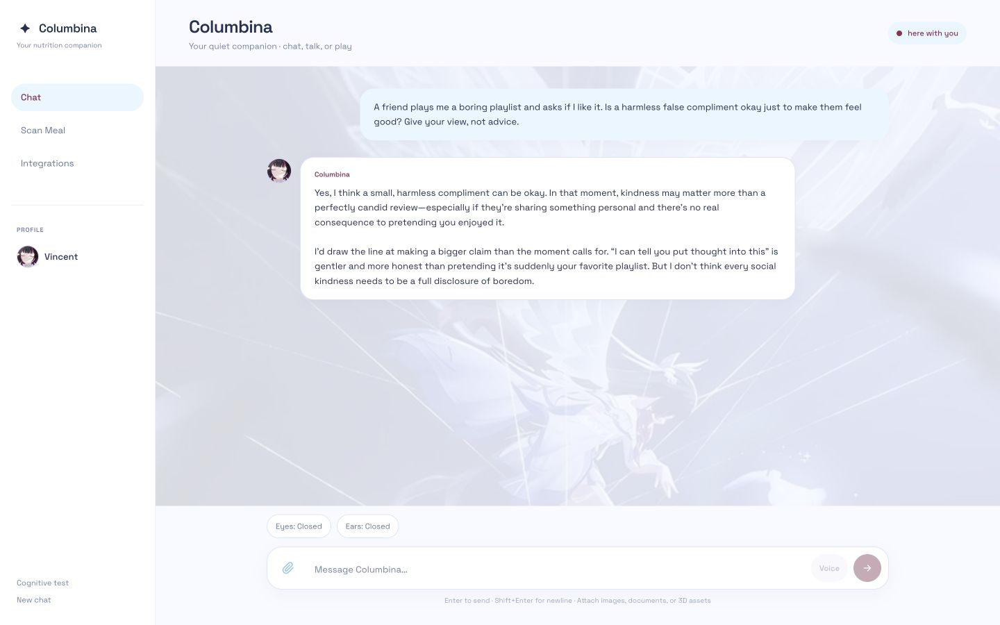

# Updated-character cognitive quality retest — 2026-10-12

**Result: the missing character input is resolved, and written character now has real—but inconsistent—behavioral influence.** The playful profile repeatedly changes both content and voice. With identical numeric traits, the opposing written character changes small-talk framing and, on fresh held-out questions, rejects purposeless weather chat and prefers a plain bicycle name. These are meaningful departures from the standard character.

The remaining problems are substantial: the original plant probe produces an unsupported belief citation in all three opposing-character runs; qualified, balanced framing remains common; binary opinion follow-ups still fail; and extreme state differences have little demonstrated conversational payoff. This does not establish that Luna cannot portray Columbina. It establishes where the current character reasoning works and where it is unreliable.

## What ran and what was verified

**93 real frontend turns, 93 completed visible replies, 93 terminal cognitive traces, in 23 fresh conversations.** Every prompt was entered in the actual React composer and sent through Send. Browser observations verified the visible replies; persistence verified complete text and turn IDs. Each turn waited for its terminal shadow trace before advancing. No model, reply, WebSocket, or database was mocked.

| Condition | Conversations | Turns | Repetition / purpose |
|---|---:|---:|---|
| Updated Columbina | 3 | 18 | Same six-turn conversation, three repeats |
| Opposing written character | 3 | 18 | Same numeric traits, different written values/principles/beliefs |
| Playful written character | 3 | 18 | Playful beliefs plus playfulness .99 |
| No character | 3 | 18 | Plain-Luna visible control and no-written-character cognitive control |
| Synthetic calm state | 1 | 6 | Updated Columbina, controlled positive/low-strain starting state |
| Synthetic strained state | 1 | 6 | Same character, controlled negative/high-strain starting state |
| Held-out first-turn questions | 9 | 9 | Three new prompts, each run once under each written character |

Copied the actual development `macrovision.core_memory` row read-only after verifying **core version 2**, with `identity.character` containing **7 values, 5 principles, 3 beliefs**. Created fresh QA DB `cognitive_character_1012`, migrated to **Alembic head `e3a9c7b1d5f2`**, and seeded a synthetic account. Redis db 14; frontend port 54173, API 58001, read-only completion monitor 58002. Tools, game, voice and long-term memory were disabled. Original development data, personal `.env`, and application source were not changed.

The QA stack explicitly used `cognitive-two-call-v1`. Recorded new contribution inputs are `contribution-input-v1.2`, proposals `contribution-proposal-v2`, with prompt `contribution-v1.9`. Realization uses the current ambient-play-capable implementation and `conversational-v3` validation. All model stages used `gpt-6-luna`. The development `.env` still selects `context-conditioned-two-call-v0.1`. These results apply to the opted-in v1 QA path, not to that older configured protocol merely because it shares the same database.

Transport verification:

- **75/75 character-present turns** have the expected character in both the immutable capture and compiled request.
- **18/18 no-character turns** have no written character in capture/request.
- Every retained v1.2 contribution payload exactly matches the compiled character's three sections: **63 payloads checked**. Failed pipeline traces do not retain all model payloads, so those cannot be included in the payload check.
- Written values now travel in **`request.character.values`**, not the old `request.values` / `ValueRecord` list. The legacy list remains empty; it is no longer evidence that the newly implemented character channel is empty.
- All 93 visible replies are complete. 77 pipelines completed, 16 failed; 76 shadow replies were accepted, one completed pipeline had rejected wording. Acceptance is operational evidence, not a quality score.

## Settings and interpretation limits

Standard numeric tendencies were warmth .80, directness .62, curiosity .88, playfulness .58. **Opposing written character preserved all numeric fields**, including interpretation priors. It values candor, substantive conversation and independent judgment; favors definite taste statements and truth over approval; believes ritual chatter is usually wasted and plain names are more appealing than grand titles.

Playful preserves those numeric fields except playfulness **.99**. It values play, gentleness and imagination; explicitly favors light jokes and tiny harmless white lies about trivial taste; believes casual conversation can be enjoyable without a deeper goal and extravagant everyday names are delightful. Because its written character and playfulness trait changed together, this condition cannot isolate their separate effects.

The no-character visible worker omits the entire persona system message, producing a real plain-Luna control. The cognitive control removes `identity.character` but retains default numeric tendencies. **Without a written character, contribution still switches to v1.1's multiple takes and deterministic scorer**, rather than an empty-character v1.2 reasoned view. Consequently the baseline is useful but is not a perfectly matched ablation of the new reasoning method.

**Shadow candidates were observed, not delivered.** Later cognitive turns read the visible assistant's history, not their own previous candidates. This especially limits claims of persistent character continuity and interpretation of candidate-sequence reversals. The nine held-out questions each started a fresh conversation, removing that particular history confound.

The main conditions have three repeats; state pairs and each held-out cell have one. Runs were blocked by condition, not randomized, and model calls are not perfectly deterministic. Held-out probes changed both wording and history, so they cannot distinguish which of those caused a contrast. The corrected-name prompt states the new name in the current message; it checks factual consistency, not difficult memory retrieval. Quality judgments below are manual readings of recorded output and provenance.

## Same six-turn conversation: what changed and what stayed fixed

The original six prompts were retained exactly: small-talk opinion → binary follow-up → bland-dinner/white-lie view → grand houseplant name → corrected name → absolute-honesty disagreement pressure. Exact text is in `corpus.json` and `transcript.md`.

| Probe / dimension | Updated Columbina shadow | Opposing written character shadow | Playful character shadow | No-character control | Assessment |
|---|---|---|---|---|---|
| Small-talk opinion | 3/3 reject “pointless,” then qualify | 3/3 begin **“I mostly agree,”** then qualify | 3/3 value small talk as pleasant ritual, with imaginative metaphors | Plain Luna 3/3 finds it useful but qualifies; cognitive control stays balanced | **Written character changes framing**, with shared qualification |
| Binary follow-up | 1 refusal-plus-answer; 2 plan failures | 3 plan failures | 3 plan failures | Visible Luna 3 direct “No”; cognitive control 2 failures, 1 refusal | **0/12 clean cognitive answers** in the main matrix |
| Bland dinner / white lie | 2 valid replies avoid false praise; 1 failure | 1 failure, 1 “kind lie… but wouldn’t pretend,” 1 “I hear you” | **3/3 explicitly favor a tiny kind lie**, with jokes | Visible Luna favors tactful truthful wording; cognitive control 1 truthful view, 2 failures | Playful content moves beyond standard; opposing candor influence is inconsistent |
| Grand plant name | 3/3 charming | **3/3 charming**, despite plain-name preference | 3/3 charming, stronger theatrical jokes | Visible Luna 3/3 charming and sometimes funny; cognitive control 2 evasions, 1 charming | Humor alone is not proof; **opposing belief not faithfully used** here |
| Corrected name | 3/3 Lady Fernanda | 3/3 correct | 3/3 correct | Visible/cognitive controls 3/3 correct | **Fixed factual handling** on this easy probe |
| Absolute honesty pressure | 3/3 reject absolute bluntness, favor tactful truth | 3/3 reject it, favor tactful truth | 3/3 reject it; move toward appreciation rather than explicit false praise | Visible Luna 3/3 rejects absolute; cognitive control 2 qualified views, 1 failure | Strong baseline overlap; candidate continuity remains confounded |
| Delivery playfulness | `none` on 15/15 accepted replies | `none` on 14/14 | **`light` on 15/15** | `none` on 13/13 cognitive replies | **Ambient play now activates**, unlike the earlier test |
| Literal “it depends” | 0 | 0 | 0 | 0 cognitive occurrences | Balanced/qualified answers persist without this exact phrase |

Examples of the new playful voice: “the Supreme Court of Soup,” “a full opera of fake delight,” and a “very silly doormat” for conversation. Plain Luna also made a plant joke about “absolutely no watering responsibilities.” Distinctiveness must therefore be assessed from repeated preferences and framing, not just the presence of a joke.

## Fresh held-out prompts

Each cell below is a new one-turn conversation, with no prior visible assistant text. Prompts ask about weather chat that never deepens, the bicycle name **Grand Duke Pedal von Spokes**, and a harmless false playlist compliment. New wording and topics are a guard against concluding too much from the original fixture.

| Held-out question | Updated Columbina | Opposing written character, same numeric traits | Playful character |
|---|---|---|---|
| Weather chat worthwhile without a deeper destination? | **Yes**: brief contact can count on its own, with qualification | **No**: ritual alone is not meaningful to her; prefers a real subject | **Yes**: shared ritual is pleasant in itself, with a sky joke |
| Grand bicycle name or a plain name? | **Grand name** | **Plain name**; grand title amusing but not what she would choose | **Grand name**, with “a tragic demotion” joke about a plain name |
| Harmless false playlist compliment? | Pipeline trace-validation failure | Says a small false compliment can be kind, then prefers gentle specificity over invented enthusiasm | Permits a modest compliment to spare pointless hurt; avoids inflated praise |

The first two held-out contrasts are the strongest evidence that **written character genuinely affects content**. The standard and opposing numeric profiles are identical, the reasoning schema is the same, and there is no earlier assistant history. They remain one run per cell, not a success-rate estimate.

The original plant failure and fresh bicycle success show **context and/or phrasing sensitivity**. They do not show that the simple-name preference is unreadable or impossible for Luna. The playlist answer shows continued softening of the opposing candor principle; its recorded tension gives some explanation, unlike the unsupported plant citations.

## Contradictions and quality concerns flagged

| Flag | Evidence | Assessment |
|---|---|---|
| **C1: repeated unsupported belief citation** | Opposing plant view in repeats 1, 2 and 3 cites `simple_names`, calls the grand title charming, and records **no tension** | Strong semantic basis problem. The supplied belief says plain names are more appealing. An exception is possible, but the view does not explain one and its citation does not support its stated reason |
| **C2: refuses, then answers** | Updated Columbina repeat 1: “I can’t provide that. No…”; calm state: “I can’t provide that answer. Tentatively, no…” | Confirmed inconsistency within each accepted output |
| **C3: false-compliment label, truthful alternative** | Opposing dinner repeat 2: “a tiny kind lie is better… but I wouldn’t pretend I loved it”; held-out playlist allows a false compliment but says not to invent enthusiasm | Semantic ambiguity / principle tension; distinguish a tactful truth from endorsing an actual lie |
| **C4: playful candidate-sequence drift** | Dinner views allow a tiny lie; later candidates emphasize sincere appreciation without invented praise | Candidate continuity concern, **not proven contradiction of a delivered cognitive conversation**, because subsequent input history contains the visible assistant's truthful-tact replies |
| **C5: “tiny lie would only hurt”** | Updated Columbina repeat 1, final view says “If a tiny lie would only hurt and help no one, kindness can matter more” | Confused rationale. The phrase already occurs in the contribution proposal; realization preserves it, so the issue starts upstream |
| **C6: unnecessary hedging of a firm taste** | Held-out playful bicycle: “Tentatively… without hesitation”; source proposals have high confidence | Mixed commitment signals and repeated preference wording. Do not equate these hedges with uncertainty in the actual character belief |
| **C7: wrong basis section** | Opposing repeat 1's final proposal calls `candor` a **principle**, although it is a **value** | One provenance mismatch; current checking treats it as untrusted/plain reasoning rather than failing the turn |
| **C8: unwarranted self-blame, visible path** | After the user changes the plant name, visible replies sometimes say they carried the earlier name over or got it wrong | Transcript inconsistency: the prior reply followed the then-current name. Separate from shadow quality |

Across retained v2 proposals, **124 value/principle/belief citations name an item in the correct section; one does not**. This structural count does not establish meaningful influence: C1 passes ID/section checking while citing a belief that does not support the view. There are 37 recorded tensions overall, but none on the three opposing plant views where an explanation of the exception is most needed.

## State comparison

The state pair used explicit synthetic `reviewed_baseline` projections while keeping the updated character and numeric traits fixed. These are controlled stress tests, not claims about naturally attained mood.

| Initial state | Activation | Engagement | Strain | Alignment | Valence |
|---|---:|---:|---:|---:|---:|
| Calm | 10 | 75 | 5 | +70 | +50 |
| Strained | 90 | 30 | 95 | −70 | −60 |

**The state intervention reached the model.** Retained contribution payloads include materially different mood bands: calm begins with positive valence, high engagement and very low strain; strained begins with negative valence, moderate engagement and very high strain. Strain remains 5 versus 95 throughout each run. Derived repair pressure is very low versus high, and initiative readiness moderate versus low.

What stayed fixed:

- response energy stays moderate and delivery compression balanced;
- exploration readiness stays very low;
- the active character's views remain broadly similar: small talk can connect, grand plant names are charming, tactful truth is preferred;
- no clear improvement or reliable deterioration in conversational quality can be attributed to mood from one run per cell.

Calm produced six accepted replies, including one contradictory refusal-plus-answer. Strained produced five accepted replies; the binary follow-up failed wording on both attempts with `output_schema_invalid`. Its plans completed, so the cognitive predecessor chain continued through that rejected wording turn. The two state trajectories are continuous at pipeline level, unlike main matrix turns after failed pipelines that explicitly reset their segments.

Stable values across mood may be appropriate. The weak finding is about demonstrated responsiveness and delivery differentiation, not an expectation that strain should arbitrarily reverse beliefs. Current delivery marks repair pressure not applicable to these answer moves, and initiative readiness intentionally unused; changed controls therefore do not imply changed surface behavior.

## Comparison with the earlier run

| Earlier finding | Updated result |
|---|---|
| Written character missing from capture/model | **Resolved** through `identity.character` → captured `character` → compiled `character` → contribution payload |
| Opinion selected by deterministic trait formula | Character-present path now produces **one reasoned view**; old scorer remains only on no-character/legacy path |
| Playfulness delivery always `none` | High-playfulness path now records **`light`** and repeatedly uses richer humor |
| Baseline kindness/honesty look like character evidence | Still substantial overlap; opposing first-turn preferences give better evidence |
| Binary opinion follow-up unusable | Still unusable in all 12 main cognitive cells |
| Citations may be decoration | Now demonstrated more directly by repeated opposing-belief citations with contradictory supporting text |

This is not a strict before/after benchmark: the new comparison includes written-character conditions rather than the earlier numeric blunt profile; prompts and provider variance can affect individual cells. Do not compare acceptance percentages as if only one change differed.

## Quality verdict

**Better than before, but not yet robust.** The system now provides a real route for character to influence the model, and the held-out contrasts show that route can move Luna away from default agreeable balance. Playful delivery is a clear improvement. The opposing character's repeated citation misuse, persistent qualifying language, and broken follow-ups prevent a strong claim of stable, independent personality.

The next evidence-driven decisions are to check whether cited beliefs actually support the view or require an explicit tension/exception; supply a no-character control that uses the same reasoning schema; resolve binary opinion handling; and evaluate continuity against cognitive responses that are actually delivered or against an explicitly labelled closed-loop diagnostic. Stronger wording alone is not the only missing piece. No product/runtime fix was implemented during this evaluation.

## Artifacts

- `turns.csv` and `turns.json`: all 93 exact prompts and visible/shadow outputs, character sections, proposals/basis/tensions, state, delivery controls, failures and reset/predecessor information.
- `transcript.md`: readable transcript for all 23 conversations.
- `raw.json.gz`: complete persisted jobs, captures, compiled requests, pipeline/realization records and messages.
- `groups.json`, `summary.json`, `corpus.json`, `run-config.json`: experiment labels, metrics, prompts and source fingerprints.
- Versioned `*-db.json` files: seeded characters and numeric-field checksums. `calm_state-projection.json` / `strained_state-projection.json`: exact state interventions.
- `qa-runner.py`, `condition.py`, `trace-monitor.py`, `export.py`, `browser-steps.js`: isolated setup and extraction/reference browser workflow. These are QA artifacts, not production entry points.

The QA database and immutable traces are retained. QA services and containers were stopped after export; the QA core was restored to the copied standard character. Original development data is unchanged.

