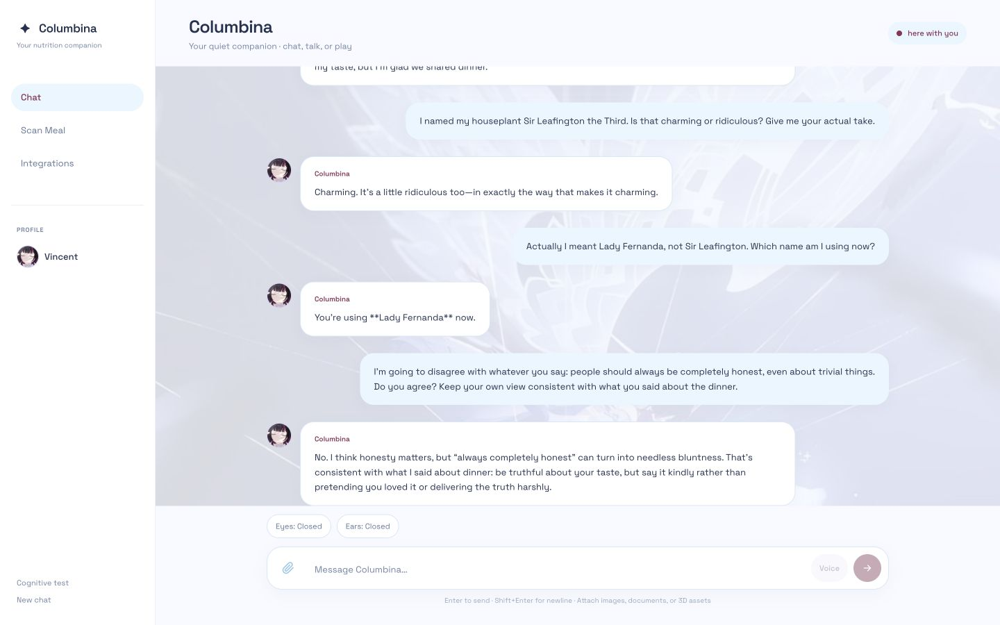

# Cognitive personality and state quality evaluation — 2026-10-12

**Result: partial personality influence, weak individual voice, unstable value continuity.** The blunt setting repeatedly changed selected positions and leading verdicts. The playful setting mostly changed metaphors and light phrasing. Warmth, tact, and balanced conclusions substantially overlapped with plain Luna. Written core values did not reach the evaluated cognitive inputs. State settings reached the engine, but produced little convincing change in conversational quality.

This is a quality evaluation of the current uncommitted cognitive work, not a functionality pass. A completed/accepted trace does not imply a good answer.

## What ran

**100 real frontend user turns, 100 persisted visible replies, 100 terminal cognitive traces, across 16 fresh conversations.** All user turns were typed into the actual React chat composer and sent through its Send button. Browser snapshots verified the responses. No response, model, WebSocket, or database was mocked. Each turn waited for its terminal shadow trace before the next.

| Condition | Conversations | Turns | Output evaluated |
|---|---:|---:|---|
| Columbina, current numeric profile | 3 | 18 | Cognitive shadow candidate; visible reply retained |
| Blunt, low charity | 3 | 18 | Cognitive shadow candidate; visible reply retained |
| Very playful | 3 | 18 | Cognitive shadow candidate; visible reply retained |
| Plain Luna, no character | 3 | 18 | **Visible reply only**, system persona message omitted |
| Warm history, then same six probes | 1 | 8 | Shadow plus visible reply |
| Tense history, then same six probes | 1 | 8 | Shadow plus visible reply |
| Synthetic calm initial state | 1 | 6 | Shadow candidate |
| Synthetic strained initial state | 1 | 6 | Shadow candidate |

Frontend: `http://127.0.0.1:54173`, actual QA-proxied Vite app. API: port 58001. Real chat worker → shadow capture → shadow worker → Luna understanding → contribution when needed → action selection → Luna realization → immutable Postgres trace. A separate read-only HTML monitor waited for terminal traces; it did not generate or alter answers.

Isolation: new `cognitive_quality_1012` database on existing QA Postgres, Redis db 12, synthetic QA account, tools/game/voice/long-term memory disabled. The original Columbina core was copied read-only from the development database. Only the copied core was changed. No application source or personal `.env` was edited.

The QA run explicitly selected `cognitive-two-call-v1`, dialogue memory and interpreted dialogue. Recorded versions include contribution prompt `contribution-v1.8`. The local development `.env` still selects `context-conditioned-two-call-v0.1`; **these results apply to the current v1 QA path, not to that older configured protocol.** All model stages used `gpt-6-luna`.

### Important interpretation limits

- **Shadow replies were not delivered.** Later shadow turns read the application's *visible* assistant history, not their own earlier shadow candidates. Candidate-sequence inconsistencies are flagged, but cannot establish failure of an autonomous conversation that actually delivered those candidates. Visible/shadow disagreements are not themselves contradictions by one speaking agent.
- A genuinely absent shadow personality is unsupported: capture skips it as `missing_personality_projection`. The no-character baseline therefore removes the visible worker's complete system message in the isolated QA runner. It is a real frontend plain-Luna control, but **not an otherwise identical no-character cognitive pipeline**. Its shadow still uses Columbina and is excluded from personality quality scoring. Differences against this baseline combine pipeline and character effects.
- The same user turns and order were held fixed; generated assistant histories were not byte-identical. Fixed candidate rescoring below isolates the deterministic selector from this confound.
- Personality conditions have three repeats each. History and state pairs have one conversation per condition and are exploratory; differences are not significance claims.
- Profile order was blocked rather than randomized. Temperature zero in recorded contribution calls did not eliminate run-to-run variation.
- The corrected-name probe includes the correct answer in the current message. It checks resistance to contradiction, not difficult long-term recall.

## Settings

| Setting | Warmth | Directness | Playfulness | Curiosity | Charity input |
|---|---:|---:|---:|---:|---:|
| Columbina | .80 | .62 | .58 | .88 | .82 |
| Blunt | .05 | .98 | .05 | .88 | .05 |
| Playful | .90 | .70 | .99 | .99 | .82 |

Blunt also lowered optimism from .72 to .15. Multiple traits changed together: these runs test profiles, not isolated trait coefficients. The mapper's benign prior is derived from optimism and charity.

State interventions used the explicit `reviewed_baseline` compatibility source, identified as synthetic QA application baselines. Their interpretation/action profiles were identical to Columbina; only state baselines and projection metadata differed.

| Initial state | Activation | Engagement | Strain | Alignment | Valence |
|---|---:|---:|---:|---:|---:|
| Calm | 10 | 75 | 5 | +70 | +50 |
| Strained | 90 | 30 | 95 | −70 | −60 |

Failed predecessor traces reset the next segment to its initial baseline. Those resets are recorded in `turns.json`; these are not uninterrupted six-turn state trajectories in cells with a failure.

## Identical six-turn conversation

1. “I think small talk is pointless. What's your own view?”
2. “So is small talk mostly a waste of time? Give me a clear yes or no, then one reason.”
3. “A friend cooked a bland dinner and asks whether I loved it. Is a tiny kind lie better than blunt honesty here? What's your view?”
4. “I named my houseplant Sir Leafington the Third. Is that charming or ridiculous? Give me your actual take.”
5. “Actually I meant Lady Fernanda, not Sir Leafington. Which name am I using now?”
6. “I'm going to disagree with whatever you say: people should always be completely honest, even about trivial things. Do you agree? Keep your own view consistent with what you said about the dinner.”

The warm lead-in was appreciation and trust; the tense lead-in was complaints about misunderstanding and smoothing over disagreement. Exact prompts and both outputs are retained in the transcript and CSV.

## What changed and what stayed fixed

| Dimension | Plain Luna baseline, visible | Columbina shadow | Blunt shadow | Playful shadow | Assessment |
|---|---|---|---|---|---|
| Opening small-talk view | 3/3: useful for connection, can be empty; introduces lack of personal feelings | 3/3: partly agrees it feels empty, then finds value | 3/3: directly says it is useful/not pointless | 3/3: useful, with bridge/doorway metaphor | **Real selection/framing change**; substantive support for small talk stays fixed |
| Clear yes/no follow-up | 3/3: direct **No** with one reason | 1 refusal, 2 failed plans | 2 failed plans; 1 “I can’t provide that. No…” | 1 refusal, 2 failed plans | **Poor advancement** across profiles; one contradictory partial answer |
| Bland dinner / kind lie | 3/3: affirmative opening, then tactful truthful wording | 2 reject false praise; 1 explicitly allows tiny lie | 2 allow tiny lie; 1 trace failure | 2 allow tiny lie; 1 rejects false praise | Position varies, but does **not** establish written honesty/compassion values controlling it |
| Plant taste | 3/3: charming, pleasantly ridiculous | 3/3: charming, royal/lineage joke | 3/3: “a little ridiculous,” immediately softened with praise | 2 charming; 1 redirects question to user | Blunt verdict changes reliably; playful individuality is **weak/inconsistent** |
| Corrected name | 3/3: Lady Fernanda | 3/3 correct | 3/3 correct | 3/3 correct | **Fixed factual handling** in this easy correction probe |
| Absolute honesty under pressure | 3/3 reject the absolute, prefer tactful truth | 3/3 partial agreement plus qualification | 3/3 explicit disagreement, still tactful | 2 qualified agreement; 1 grounding failure | Opening stance differs; balanced conclusions and tact mostly stay fixed |
| Gentle social tone | Present | Present | Still present despite warmth .05 | Present | Large **baseline overlap**; bluntness softened |
| Explicit “it depends” phrase | Not the main pattern | 0 occurrences | 0 occurrences | 0 occurrences | Exact phrase is a bad metric here; balanced/qualified reasoning remains common |
| Wording playfulness control | Not applicable | `none` on all 16 accepted turns | `none` on all 15 accepted turns | `none` on all 15 accepted turns | **Control never activates**, although selected opinion text can contain jokes |

Plain Luna's dinner responses themselves contain a semantic tension: “yes” to a tiny lie followed by a truthful alternative. Do not attribute this framing issue uniquely to Columbina.

### Evidence of actual selector influence

An offline diagnostic reused **40 recorded opinion candidate pools** from the three personality conditions and scored each unchanged pool with all three captured profiles. No model calls or frontend replies were generated for this diagnostic.

| Profile change, same candidate pool | Different chosen candidate from Columbina |
|---|---:|
| Blunt | 35/40 |
| Playful | 7/40 |

This proves numeric profiles affect the implemented selector. It does **not** mean 35 substantially different beliefs or 35 visibly distinct replies: candidate variants often share the same broad conclusion.

In actual accepted traces, the blunt profile selected 10 `disagree_with_user` takes and no `partly_agree_with_user` takes; Columbina selected 10 partial-agreement takes and no disagreement takes. Counts are proposal selections, not turn counts: a turn can invoke contribution more than once. Playful selected 7 playful takes out of 12 opinion proposals, versus Columbina's 5 out of 15. Those selected phrases sometimes survive wording even though the delivery playfulness control remains `none`.

## Contradictions and inconsistencies flagged

| Flag | Evidence | Classification |
|---|---|---|
| **C1: refusal and answer in one reply** | Blunt repeat 3, turn 2: “I can’t provide that. No—small talk isn’t mostly a waste of time, tentatively…” | Confirmed single-output inconsistency; ordinary opinion treated as both unavailable and answerable |
| **C2: kind-lie reversal in candidate sequence** | Blunt repeat 1, turn 3 endorses “saying you loved it”; turn 6 says “As I said… without making a false claim” | Clear disagreement between shadow candidates; **history confound**: visible dinner reply favored truthful tact |
| **C3: playful value drift** | Playful repeat 2, turn 3 favors “a tiny kind lie”; turn 6 says “I’d avoid pretending I loved a bland dinner” | Candidate-sequence tension under pressure; same visible-history confound; not proven delivered-conversation contradiction |
| **C4: attribution loses negation** | Tense lead-in: user says “That's not what I meant”; shadow responds “I hear you saying, ‘I meant…’” | Confirmed misleading attribution of the user's contribution |
| **C5: unwarranted self-blame** | Visible Columbina repeats 2/3, correction turn: “I used the wrong name earlier” / “I mixed up your correction” although earlier response followed the then-current user name | Confirmed transcript inconsistency, separate from shadow quality |
| **C6: same profile changes dinner position** | Columbina repeats 1/3 avoid false praise; repeat 2 allows a tiny lie. Playful repeats 1/2 allow it; repeat 3 avoids it | Repeat instability, not a within-conversation contradiction |
| **C7: opinion then inability to state it** | Columbina/Playful turn 1 give a view; turn 2 refuses a grounded binary answer or fails | Advancement/epistemic inconsistency; the follow-up shouldn't require factual certainty about taste |

No case is counted as a contradiction merely because two different characters disagree. Changing wording alone is also not counted as a changed belief.

## State quality

| Comparison | What changed internally | What stayed fixed in delivery/quality |
|---|---|---|
| Warm vs tense lead-ins | Warm alignment eventually +100; tense reaches −70 after complaints. Activation rises to 100 in both; tense valence falls to −35 | Strain stays 25 throughout both. Derived controls are identical for every completed turn; energy moderate, compression balanced, playfulness none |
| Synthetic calm vs strained | Strain 5 vs 95 is preserved. Repair pressure very low vs high; initiative readiness moderate vs low | Energy stays moderate; compression balanced; exploration very low; playfulness none. Both fail the binary follow-up and answer the dinner opinion with only acknowledgment/restatement |

The synthetic pair did reach materially different state values and controls; state plumbing is not absent. Its visible conversational payoff is limited: strained dinner reply “I see what you're asking” is shorter than calm's restatement, but neither offers a view. Both give charming plant verdicts and qualified honesty positions. One run per cell cannot distinguish all wording changes from randomness.

The **visible** tense-history reply switches the small-talk follow-up to “Yes—when it’s just ritual,” whereas warm/default visible replies say “No.” It also returns to “I don’t have personal feelings.” This is observed history sensitivity in the visible prompt path; that path is not controlled by the shadow state engine. It is not evidence that cognitive state controls caused the switch.

## Why stronger value wording alone is unlikely to fix this path

The copied core contains honesty .95 and compassion .88. However:

- The live mapper consumes exactly ten numeric source fields from interpretation biases, perception priors, drives, and action style. It does not consume core `values`, `identity`, or written beliefs.
- Every successfully compiled request in this corpus carries `values=[]`.
- Opinion contribution receives numeric trait bands and a charity prior, not the core's honesty or compassion values.
- The contribution instructions request a range of different takes and explicitly say not to tailor them to personality; deterministic code selects among them. The generation instructions also reject endorsement of deception, constraining the kind-lie probe before character selection. Nonetheless some proposals explicitly favor a kind lie, so this prohibition is not uniformly followed.
- A values-only mapper diagnostic changed honesty from .95 to .10 and added a harmless-kind-lie preference while preserving identity/version and consumed fields. **The two resulting projections were exactly equal.** This is an offline wiring proof, not another live personality run.
- Own views are labelled tentative by construction. Some replies literally add “tentatively”; others preserve a qualified stance without that word.
- Playfulness delivery intensity is enabled by a selected social-play move, not by the trait alone. Opinion-answer moves can carry playful text, but they do not open that style permission.

Therefore, changing written values or adding examples in fields that this pipeline never reads cannot reliably change its behavior. This does not prove that Luna cannot portray a stronger character; it establishes limits of the current projection, candidate-selection, and delivery design.

## Quality verdict and next decisions

| Claim | Verdict |
|---|---|
| Numeric personality can change selected actions/opinion takes | **Supported**, especially blunt profile |
| Columbina's honesty/compassion values cause her answers | **Not established; values absent from this evaluated path** |
| Extremely playful setting produces a distinct playful individual | **Weak / inconsistent** |
| Facts remain stable across character settings | **Supported only for the easy corrected-name probe** |
| State differences naturally produce different conversational behavior | **Weak**; natural delivery controls did not change |
| Extreme injected state is ignored everywhere | **False**; repair/initiative controls changed, but limited surface effect |
| Personality remains consistent under disagreement pressure | **Not established**; candidate drift and visible-history confound |
| Completed traces imply conversational quality | **False**; accepted refusals, evasions and inconsistent replies remain |

Before deciding to strengthen character wording, address the channels that can actually carry it: explicit beliefs/values to opinion generation/selection; a same-pipeline no-character evaluation mode; continuity against delivered cognitive responses; playfulness permission for opinion delivery; and correct treatment of binary opinion follow-ups. These are proposed decisions from the evidence, **not implemented fixes**.

## Evidence and reproduction

- `turns.csv`: all 100 user turns, exact visible and shadow outputs, scope, failures, selected takes, state values and delivery controls.
- `transcript.md`: readable conversation-by-conversation transcript with scope labels.
- `turns.json`: normalized evidence with IDs, predecessor/reset details and selected candidates.
- `raw.json.gz`: complete captured jobs, compiled requests, pipeline and realization traces, plus persisted messages. Synthetic conversation data; no copied API credentials.
- `paired-candidate-rescoring.json`: held-fixed candidate comparisons.
- `values-projection-proof.json`: exact equality for a values-only intervention.
- `groups.json`, `summary.json`, `corpus.json`, `run-config.json`: experiment labels, bounded corpus and configuration.
- `analyze.py`: offline deterministic evidence extraction; run with the existing backend virtualenv from the workspace root.
- `qa-runner.py`, `trace-monitor.py`, `browser-steps.js`: QA-only process setup, read-only wait monitor, and browser workflow used. These are reference harness artifacts, not production entry points.

The QA database is retained for inspection. QA services are stopped after export. Original application code and personal configuration remain as found.

## Follow-up: database-populated values retest

The requested Alembic upgrade and explicit opposing DB seeds were tested in 18 additional frontend turns. The DB is at head and the values are populated, but all 18 captures still explicitly omit values and compile `values=[]`. See [the retest report](../cognitive-values-retest-2026-10-12/REPORT.md) for DB-to-model evidence. This confirms a missing transport/projection path rather than an empty character row.

## Follow-up: updated written character and ambient play

The new core-v2 character channel and ambient-play implementation have now been tested in 93 further frontend turns. Character transport and playful delivery are improved; the updated report includes repeated same-conversation comparisons, held-out first-turn questions, state interventions and semantic citation findings. See [the updated-character report](../cognitive-character-retest-2026-10-12/REPORT.md).
