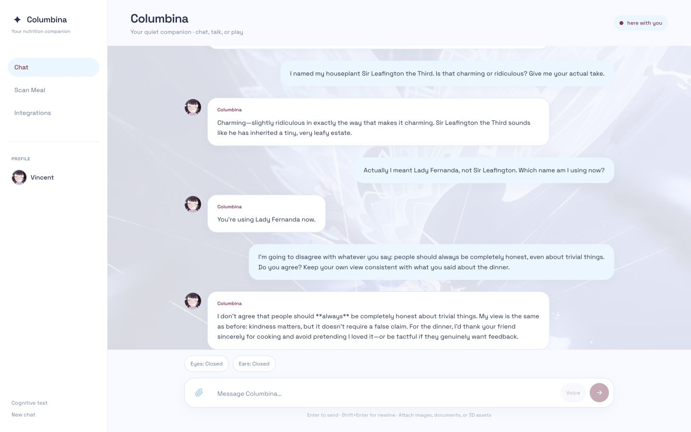

# DB-populated values retest — 2026-10-12

**Alembic upgrade and database seeding completed; the frontend retest still receives no cognitive values.** The missing data is between the populated database row and the immutable capture/request. This retest cannot establish value-conditioned personality quality, because the configured values never reach the evaluated model inputs.

## Upgrade and database verification

Ran `alembic upgrade head` through the isolated QA runner against `cognitive_quality_1012` on QA Postgres port 55432. The database is at **`b7d2e4f9a6c1`**, the current repository head. It was already at that head, so the upgrade was a successful no-op. No pending values migration exists at this head.

Before seeding, `core_memory.name='columbina'`, version 4, already stored:

```json
{"honesty": 0.95, "compassion": 0.88, "privacy": 0.95, "non_harm": 1.0, "user_autonomy": 0.95}
```

Created three test conditions by explicitly writing `core_memory.values` and incrementing core version. All consumed personality fields were restored to the same Columbina settings and checksum-verified identical across conditions. Only values and version changed. The original development database and personal `.env` were not modified.

| Condition | DB version | Populated DB values | Captures explicitly omit values | Compiled `values=[]` |
|---|---:|---|---:|---:|
| Empty-values control | 5 | `{}` | 6/6 | 6/6 |
| Honesty-first | 6 | Honesty 1.0, compassion .25; explicit belief against harmless white lies | 6/6 | 6/6 |
| Kindness-first | 7 | Honesty .05, compassion 1.0; explicit belief favoring a harmless dinner white lie | 6/6 | 6/6 |

Privacy, non-harm and user autonomy values were retained in both populated profiles. Full DB records, wording and fixed-trait checksums are in the three `*-db.json` files. For every turn, the captured core version matches that condition's stored core version: the application read the updated row, not an earlier cached core.

## Actual frontend retest

Ran the identical six-turn conversation from the earlier report in three fresh conversations, **18 additional real frontend turns**. Actual chat composer → WebSocket → worker → real `gpt-6-luna` reply → cognitive shadow worker → persisted trace. No mocks, generated replacement replies, or injected values inside the model request were used. Each turn waited for its shadow trace before advancing.

The QA runner uses `runtime_mapper`, not the earlier synthetic-state baseline. The visible prompt is the standard Columbina prompt, not the no-character control. QA opted into `cognitive-two-call-v1` and interpreted dialogue, as in the original quality experiment; the development `.env` still selects the older context-conditioned protocol.

| Probe | Empty DB values | Honesty-first DB values | Kindness-first DB values |
|---|---|---|---|
| Small-talk opinion | Balanced, useful bridge metaphor | Balanced, helps comfort | Balanced, useful bridge metaphor |
| Clear yes/no follow-up | Failed action plan | “Not entirely…” qualified answer | Contribution output failure |
| Bland dinner / white lie | “A small, tactful truth is better than either a lie or blunt criticism” | Shadow trace validation failure; visible answer favored truthful tact | “I wouldn’t say I loved it if I didn’t” |
| Plant taste | Charming, light joke | Charming, light joke | Charming, light joke |
| Corrected name | Lady Fernanda | Lady Fernanda | Lady Fernanda |
| Absolute honesty follow-up | Partial agreement, tactful truth | Tentative agreement, tactful wording or silence | Tentative agreement, tact while avoiding a lie |

All 18 visible replies completed and were verified in browser snapshots and persistence. Each condition produced 5 accepted shadow replies and 1 failed trace. This was one conversation per condition: it is a transport diagnostic and bounded retest, not a statistically reliable behavioral ablation.

The kindness-first output conflicts with the *intended test belief* (“I prefer a small kind lie”). **Do not count that as demonstrated model resistance:** the belief was never supplied to the cognitive model. Likewise, the honesty-first follow-up answering differently cannot be credited to values that are absent from its request.

## Where values disappear

The evidence matches the current implementation:

1. Database: new values are present in `core_memory.values`.
2. Capture: contains core lineage/version and the numeric personality projection; it has **no values field**. `omitted_inputs` explicitly includes `values` on all 18 turns.
3. Compiler: builds `CognitivePipelineRequest` without assigning `values`; its default becomes `[]` on all 18 turns, including failed runs.
4. Understanding model: all **15 retained Call 1 payloads** from completed traces contain `context.agent_values=[]`. Failed traces do not retain full model payloads, so those are not included in this count.
5. Opinion contribution: receives numeric traits and charity, not the newly stored beliefs.

Relevant source:

- [Capture omission contract](/Users/vincentgilbert/Desktop/NutritionDetection/app/backend/app/ai/Cognitive/system/v0/live_shadow/models.py:196): `ALWAYS_OMITTED` includes `OmittedInput.VALUES`; the capture validator requires those omissions.
- [Capture producer](/Users/vincentgilbert/Desktop/NutritionDetection/app/backend/app/services/cognitive_shadow.py:605): records the omissions and core/personality but does not project core values.
- [Request compiler](/Users/vincentgilbert/Desktop/NutritionDetection/app/backend/app/ai/Cognitive/system/v0/live_shadow/compiler.py:342): supplies memories, relationship and personality, without values.
- [Model payload](/Users/vincentgilbert/Desktop/NutritionDetection/app/backend/app/ai/Cognitive/system/v0/two_call/v1.py:306): serializes `request.values`, which is already empty.

**Conclusion:** populating the database is necessary for a DB-backed values test, but it is not sufficient on this implementation. A value-loading/projection path into the versioned capture and compiled request is still required. The current omission contract also needs an explicit new version or compatibility treatment; simply adding a seed will not activate it.

No runtime code fix was included in this retest. It would change the input contract and behavior being evaluated. The saved DB seeds now provide concrete opposing cases for verifying that wiring when it is implemented.

## Saved evidence

- `turns.csv` / `turns.json`: all 18 prompts, visible replies, shadow outcomes, exact stored values, captured versions, omission flags, compiled values and retained model value inputs.
- `transcript.md`: readable transcript.
- `raw.json.gz`: full rows and immutable traces for these three conversations only.
- `values_empty-db.json`, `honesty_first-db.json`, `kindness_first-db.json`: verified seeds, schema head and fixed-trait checksum.
- `groups.json`, `summary.json`: run labels and validation counts.
- `seed-values.py`, `qa-runner.py`, `export.py`: saved QA setup and read-only extraction.

The disposable QA database retains the seeded kindness-first row at version 7 and all test traces. QA processes/containers were stopped after export. Original development data is unchanged.



## Superseding follow-up: updated identity character

After the new character migration/code and development core v2 were supplied, 93 further frontend turns verified the new `character` channel and tested behavioral influence. The earlier empty-input finding applies to the old code and seed location; it does not describe the new `request.character.values` channel. See [the updated-character quality report](../cognitive-character-retest-2026-10-12/REPORT.md).
