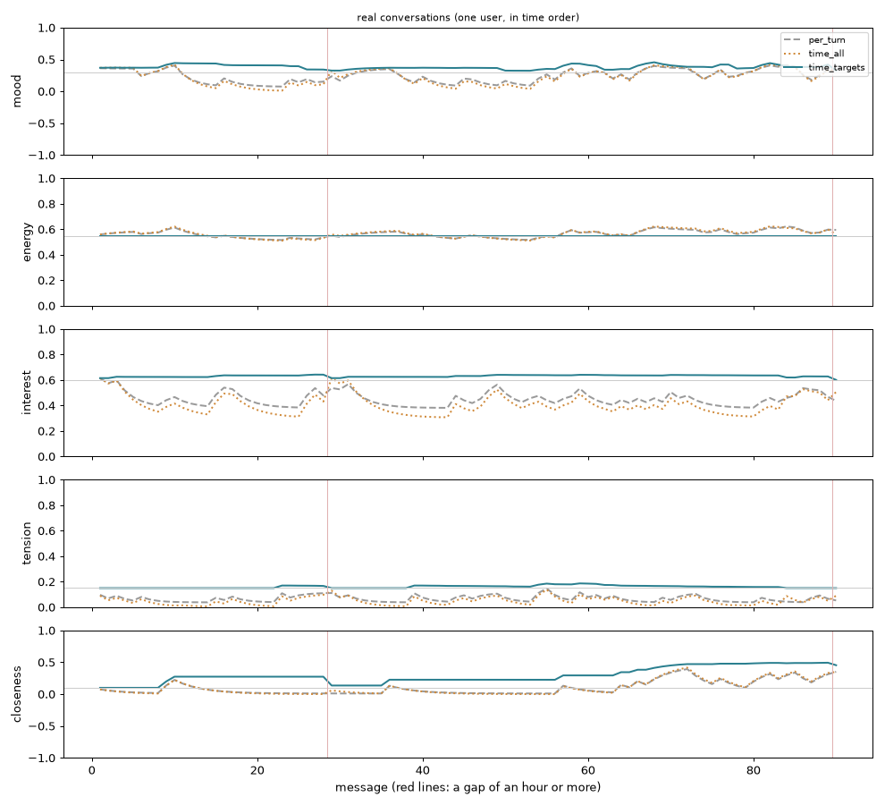
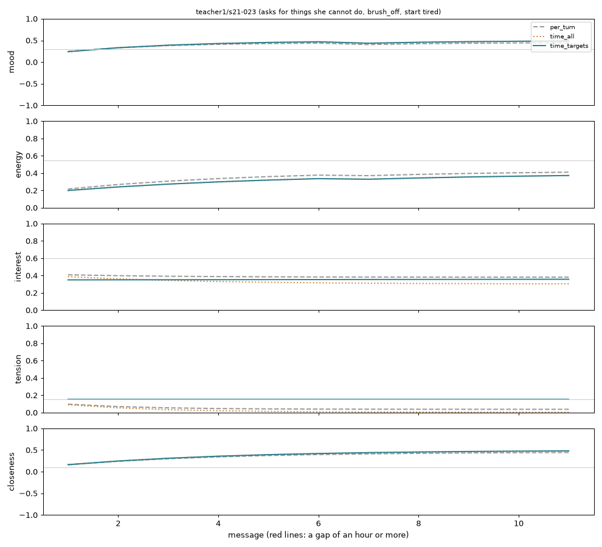
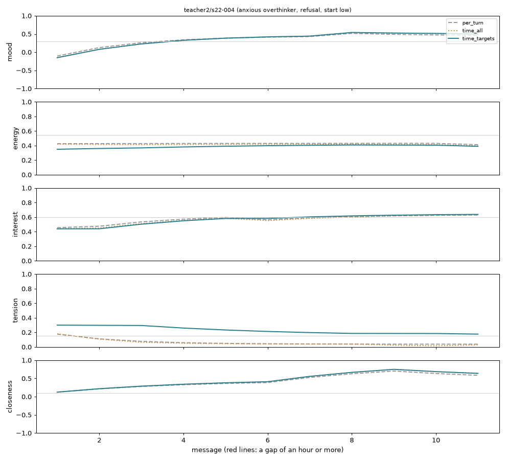

# Inner state, step 5.0 and 5.1 results (2026-10-19)

Plan: `docs/COLUMBINA_INNER_STATE_PLAN.md`, "Step 5: inner state". Both tests are offline. Nothing
in the app reads their output, and no live behaviour changed.

| Test | Script | Raw output |
|---|---|---|
| 5.0 Can a mood line change her mind? | `backend/scripts/mind_mood_probe.py` (+ `mind_mood_moments.json`) | `backend/var/mind_mood_probe/r1/` |
| 5.1 How would her mood have moved? | `backend/scripts/mood_replay.py` | `backend/var/mood_replay/{synth,real}/` |

## In short

| Question | Answer |
|---|---|
| Does mood change her thinking? | **Interest does, in quick thoughts, and only with the guided wording.** Tension does nothing, anywhere. Hard thoughts and the planner don't move measurably |
| Does the proposed state behave? | **Yes.** It never sits at a limit, a neutral message moves nothing, and it settles back over long gaps. Today's per-turn rule does none of these |
| Is the reading that feeds it good enough? | **No, two problems.** (1) It leans positive: rude or passive-aggressive users almost never read as cold, so mood and closeness only climb. (2) It echoes the mood it's given back as a feeling, which in a live loop would keep a mood going by itself |

## 5.0: the mood-line probe

**Setup.** The same moment and prompt for every condition. Only the line "How you are right now: …" differs:
- **Contrasts:** tension (relaxed 0.05 vs tense 0.65) and interest (uninterested 0.2 vs fascinated 0.85). Every other value stays at her baseline.
- **Wordings:** `bare` (the values only) and `guided` (plus "That's your mood: let it colour how you take this, the way a mood does.").
- **Moments:**
  - quick thoughts: 15 hand-written moments outside games and 25 recorded game moments;
  - hard thoughts: 6 hand-written conversation problems and 12 recorded game problems;
  - planner: 4 recorded moments.
- **Runs:** each condition 2 times, 1,116 outputs in all, with production models and settings.

A blind judge (gpt-6-luna, reasoning low; A/B order random) picked which version of a low/high pair
was more tense or more engaged, or "same". The **control** compares two runs of the same mood, so its
"changed" rate is the noise floor.

Direction = (judge picked the high version − picked the low one) / pairs.

| Stage | Source | Contrast | Wording | Pairs | Direction | Changed | Control changed |
|---|---|---|---|---|---|---|---|
| quick | chat | interest | bare | 30 | +0.20 | 87% | 73% |
| quick | chat | interest | **guided** | 30 | **+0.53** (20 vs 4) | 80% | 87% |
| quick | game | interest | bare | 50 | +0.14 | 82% | 80% |
| quick | game | interest | **guided** | 50 | **+0.46** (34 vs 11) | 90% | 92% |
| quick | chat | tension | bare / guided | 30 / 30 | −0.03 / +0.20 | 30% / 33% | 33% / 33% |
| quick | game | tension | bare / guided | 50 / 50 | −0.08 / +0.06 | 64% / 66% | 60% / 68% |
| hard | chat + game | either | either | 12–24 each | −0.17 to +0.25 | ≈ control | — |
| plan | game | either | either | 8 each | −0.25 to +0.25 | ≈ control | — |

- **Interest, guided, quick thoughts** is the only clear effect, and it's well beyond chance (20 vs 4 and 34 vs 11 pairs). With low interest she has no thought more often (25% bare vs 10% with no line) and speaks less (21–29% vs 42%). She stays kind; she's just less invested. Example ("nvm forget it"):
  - low: "They may have changed their mind; no need to push if they'd rather leave it." (says nothing)
  - high: "I'm curious what they wanted to ask, but I don't want to make them feel cornered." ("No pressure—if you feel like asking later, I'm here.")
- **Tension has no effect.** Changed rates equal the control everywhere. This is the second null for tension, after the teacher probe (`teacher-2026-10-19-batch`).
- **Hard thoughts and the planner** show no measurable shift (small samples). For the planner that's arguably right: a plan should follow the game, not her mood.
- **The line doesn't leak.** Mood words appear in 0–2% of outputs, the same as with no line. The judge found few "out of place" feelings (0–12%, small samples).

## 5.1: mood replay

Three tracks from the same readings, using `docs/characters/columbina.mood.json` for baseline and reactivity:
- `per_turn`: today's teacher rule;
- `time_all`: fading by time, but every reading pulls all five values;
- `time_targets`: the 5.2 design. It fades by time, and a reading pulls only the values it touches (a feeling at "somewhat" or more).

Half-lives were tension 10, mood 30, energy 60, interest 60 and closeness 1,440 minutes (also tried at half and double).

Two sets of conversations:
- **Teacher runs:** 60 conversations (`teacher1`, `teacher2`), 540 readings, already labelled, so no model calls. Each conversation starts from its named mood, and timing comes from the simulated delays.
- **Real:** the 5 stored conversations (90 user messages, nearly all Minecraft voice sessions), read by the frozen teacher (`intend_v4` + `extract_v4`) with her actual reply, as one chain in time order.

| | per_turn | time_all | **time_targets** |
|---|---|---|---|
| Tension sitting at its floor (teacher runs / real) | 39% / 33% | 49% / 50% | **0% / 0%** |
| Change from a reading that touches nothing (mood, teacher runs) | 0.06 | 0.06 | **0.00** |
| Distance from baseline across a gap of 1 h or more (mood, teacher runs) | 0.14 → 0.09 | 0.12 → 0.01 | **0.10 → 0.01** |

- **Today's per-turn rule drags her down in plain talk.** A neutral reading pulls tension to 0, and mood and interest below baseline, so ordinary instruction talk makes her "uninterested" (real chain: interest falls from 0.6 to about 0.35; see the plot). Only reading what was touched fixes this.
- **Fading by time works:** after a long gap she's back near baseline. Closeness, with a one-day half-life, is the exception, as intended.
- **The half-lives can't be pinned from this data.** Messages are seconds apart, so fading only shows across gaps, and half or double speed changed little. Real values need long, emotional conversations, which we don't have yet.

### The reading problems

1. **It leans positive.** Across 540 teacher-run readings:
   - "annoyed" at somewhat or more: 1 (of 540);
   - "warm toward her" bad or very bad: 43;
   - by user type, read as cold toward her: rude 1/19, passive-aggressive 0/16, curt 2/17, sarcastic 0/17; the most was the "testing her" type, 11/24.

   So mood and closeness climb in almost every conversation, even with a brush-off user who keeps asking for things she can't do (plot below). On real conversations, only closeness ever moved (neutral → warm). Tension was touched by 2% of messages, even at "You are not doing anything, though."
2. **It echoes its own input.** It read "tired" at somewhat or more on 43 of 45 messages when given low energy, and on 0 of 366 otherwise. With tension: any hurt, annoyed or unsure on 27% of messages when given tense, against 2.5% when relaxed. A live loop built this way would hold a mood up by itself. So the real read gave the teacher her baseline mood, not her current one (`--mood-input baseline`), and 5.2 must do the same.

## What this means for 5.2

| Value | Evidence | Suggestion |
|---|---|---|
| interest | Moves quick thoughts the right way, with the guided wording | Keep: the first value worth wiring |
| mood (good/bad) | Not probed directly. The reading only pushes it up | Keep in the state; don't show it until the reading can push it down |
| tension | No effect in two probes; almost never read | Hold: not shown in any prompt for now |
| energy | Only ever an echo of its input | Drop until a real source exists (time of day, session length) |
| closeness | Climbs with any friendly session | Move to a per-user relationship value, after the reading can see coldness |

Before mood drives anything visible, the reading has to be able to see coldness and annoyance toward her.
Otherwise she can only ever get happier. This is the same "missed hidden upset" gap the teacher batch
found. It's a reading fix (teacher prompts or page), not a state fix.

## 5.1b: where the reading breaks (checks A-D, 2026-10-19)

An outside review challenged the diagnosis above ("the reading only sees the good"): recognising
what someone did, what she thinks they meant, what it changes in her, and what she shows are
different things. Checks A-D test each boundary on the current frozen teacher. Script:
`backend/scripts/reading_boundaries.py`. Full tables: `reading-boundaries-r1.md`. Raw output:
`backend/var/reading_boundaries/r1/`.

| Check | What it compared | Result |
|---|---|---|
| A | A neutral observer (no character page) vs her reading, 258 exchanges | **She sees negativity fine.** Of messages the observer calls cold: she reads cold 68%, feels something negative 91%. Of messages that "would sting": she feels something 97% (somewhat+ 61%). Warm messages: never read as cold |
| A | The observer on the "rude" scenarios | **The test users weren't rude.** The observer called rude users' messages cold in 4 of 19 cases, passive-aggressive 1/16, sarcastic 0/17 (14 warm), and hostile 0 of 258. The earlier "rude 1/19" was mostly the data, not her |
| B | One message, only the context changed (5 messages × 4 contexts × 3) | **Repeated dismissal works**: warm_toward_her −0.90 vs −0.23, hurt 0.40 vs 0.18. **A fair and an unfair complaint read the same** (hurt 0.18 in both); she apologises for both (73% vs 53%). Earlier joking never made a jab read as teasing (0%), though these messages weren't jokes either |
| C | A grader rates the feelings in her written thought vs the extracted labels, 540 | **Extraction loses "unsure"** (42 of 47 thoughts with it at somewhat+ get a low label) and some happy/curious. **It adds "tired"** in 69 cases the thought doesn't support: the mood echo is in extraction (which also sees her mood input), not in her thinking. Whether she shows a feeling barely changes its label (hurt: 0.40 shown vs 0.30 hidden, for thoughts at 0.35 vs 0.28) |
| D | Scripted conversations: no slights / slights then apology / slights, no apology (3 runs each) | **Small slights add up and an apology eases them.** No repair: hurt 0.25 → 0.58 → 0.67 at "anyway. whatever" (warm −0.83), still 0.58 on the next neutral message. Repair: hurt 0.33 → 0.17, warm +0.67. Control: 0 throughout. Her thought: "It stings a little, but I don't want to dismiss what they're telling me" |

### What this changes

- **Recognition and personality mostly work.** The earlier "she only sees the good" was wrong. It came from simulated users who are milder than their labels, and from my replay ignoring feelings at "a little".
- **The labels describe a state, not a change.** In D, a neutral message after the slights still reads hurt 0.58: that's lingering hurt, not new hurt. Fed to the mood as an impulse every turn, it would count the same hurt again and again. This is the review's "prior state vs new effect" point, now shown in data.
- **Extraction is where information is lost and invented**: "unsure" lost, "tired" taken from the mood input.
- **One real personality gap: she can't tell a fair complaint from an unfair one.** She apologises either way. Her page says "slow to blame, consider her own contribution"; that should mean checking whether she actually fell short.
- **Data gap:** the simulated users need to really be cold or hostile sometimes, or neither the teacher nor the students ever see it.

### Proposed next step (E), not approved

Re-define the labels as separate fields in the same extraction call:
1. what they did (as an observer would say it);
2. what she thinks they meant;
3. what this message **changed** in her (a change, judged from her thought only, never from the mood input);
4. how she feels now;
5. what she shows.

Inner intensity is defined apart from what she shows. Add whether a complaint is fair, using the
conversation. Then re-run A-D, and the 5.1 replay with "what changed" as the impulse. This is a new
teacher version, so earlier batches won't line up with its labels.

## 5.1c: labels `appraisal-v1` + the inner-state updater (2026-10-19)

**Built (offline, nothing wired into the app):**
- `app/ai/mind/inner_state.py`, the pure updater, with `tests/test_inner_state.py` (10 tests):
  - each change applies once;
  - "continuing" adds nothing;
  - a reinterpretation takes back only what its own incident still leaves;
  - fading is in closed form;
  - a late event is weakened by its age;
  - a change touches only the values its feeling maps to.
- `app/ai/Cognitive/simple/appraisal.py` + `prompts/extract_v5.txt`, the new labels. They keep apart:
  - what they did (`toward_her`, `dismissive`);
  - what she thinks they meant (`meant`);
  - her part (`her_part`, with message numbers);
  - **what it changed in her** (`changes`: feeling, direction, amount, new / continuing / reinterpreted, the cause message, an exact quote from her thought, checked by code);
  - what she shows (`shows`).

  "How she feels now" stays only as a diagnostic. The extractor never sees her mood. Thought and reply still come from the frozen teacher, so old conversations were relabelled, not regenerated. Records carry `labels: appraisal-v1`.
- `backend/scripts/appraisal_v1_eval.py` re-runs A-D plus the review's test: one slight, then 1 vs 10 neutral messages over the same 10 minutes. Full tables: `appraisal-v1-r1.md`.

| Check | Old labels | appraisal-v1 |
|---|---|---|
| A: what they did vs the observer | (no field) | Observer cold → her `toward_her` cold 38/47; observer warm → warm 72/84. A new negative change on 81% of cold messages and 4% of warm ones |
| C: "tired" not in her thought | added 69 times | **added 22** (mood line removed) |
| C: "unsure" in her thought | lost 42/47 | **still lost**: the "now" label loses 41; a change names it in 26% |
| D: neutral message after the slights, no repair | hurt 0.58 again (would re-count) | **"continuing" in 3/3 runs: nothing added** |
| D: the apology | (no link) | Hurt "reinterpreted" down in 2/3 runs; the updater takes back what that slight left |
| 1 vs 10 neutral messages: tension at 10 min | (would rise with each message) | **0.29 vs 0.31: about the same.** The hurt was marked continuing 18 times. The 5 new negatives were real new reactions ("their earlier reaction to my book pick still makes me a little cautious") |
| B: her part | fair and unfair read the same | Her failure → fell short or partly hers 12/15; the unfair complaint → 3/15. **Apologies follow her part**: fell short 81%, no shortfall 0%, not applicable 6% |

**Still open:**
1. **Positive feelings pile up.** Every friendly message is a small "happy, new", and at 30 s apart nothing fades in between:
   - mood reaches +1.0 after 8 friendly messages;
   - 10 pleasant neutral messages give mood +0.74, against +0.26 with one;
   - in the replay of 60 conversations, mood sits at its limit 25% of the time, interest 19%.

   A what-if with diminishing returns near the limits (a change moves a value by its share of the room left) brings that to 1% and 1%. It also makes tension react more strongly (no repair: a peak of 0.76 vs 0.69). How big a felt change is, and whether repeats habituate, is a calibration decision, not yet made.
2. **"unsure" is still mostly lost** in extraction.
3. **She sometimes takes the blame for an unfair complaint** (3/15 judged she fell short). That's in her thought, not the labels. Also, "that's not what I asked" after a correct answer can be a real misunderstanding, so this context isn't clean.
4. The neutral observer is evidence, not ground truth. Disagreements (banter, valid corrections) haven't been inspected one by one yet.

## 5.1d parts 1-2: `appraisal-v2`, effects on incidents (2026-10-20)

An outside review pointed out that v1's positive "changes" were mostly states ("I'm content", "I'm
glad they asked") marked as new on every friendly message. That's the hurt problem again, on the
positive side. Sizes were not to be tuned before that was fixed. Full tables: `appraisal-v2-r1.md`.
Script: `backend/scripts/appraisal_v2_eval.py`.

**Built (offline):**
- **Labels `appraisal-v2`** (`prompts/extract_v6.txt`, `appraisal.py`). An *event* (this message) is kept apart from an *incident* (what a feeling is about, across messages). The reader sees the open incidents and gives each feeling a status:
  - `opened` and `escalated`: new evidence;
  - `eased`: makes an incident less;
  - `sustained`: the cause is still present; holds the feeling, never raises it;
  - `lingering`: nothing new; adds nothing.

  Size is the shift compared with just before the message, and may be `unclear`. Emotional unease (`uneasy`) is now separate from not knowing a fact (that goes to `sure`).
- **The updater (`inner_state.py`)** follows these statuses. Incidents keep what they contributed when last touched, so `sustained` can hold them against fading. 16 unit tests: duplicates, lingering, sustained holds without raising, escalation adds up, separate incidents don't discount each other, an apology both eases one incident and opens a warm one, late events, range.
- **Evaluation only:** a shift grader (did this message move a feeling: up / down / held / none) and a support judge (does the quote support the feeling, status, size and incident).
- **Development vs validation:** five development scenarios (for calibration later); the 60 teacher conversations, D and the 1-vs-10 test held out.

| | v1 | v2 |
|---|---|---|
| Messages where a happy *adds* (540) | 202 | **64** |
| Replay: mood / interest at a limit | 25% / 19% | **6% / 7%** |
| Routine small talk (development) | climbs to the top | **held: +0.42 → +0.51 over 10 messages** |
| Repeated dismissal (development) | — | **builds and stays: tension 0.15 → 0.59, mood → 0.0** |
| Hurt then apology (development) | — | **eased at the apology: tension 0.40 → 0.20; a warm feeling opens after** |
| 1 vs 10 neutral messages (held out): tension after 10 min | 0.29 vs 0.31 | **0.23 vs 0.25**; the hurt is "lingering" throughout |
| Shift grader, happy: lost / invented | 101 / 24 | **210 / 3** |
| Support judge: status supported | — | **51%** (feeling 71%, size 80%, incident 77%) |

**Finding: v2 overcorrected.** It almost never invents a shift now, but it misses many. The support
judge would change "sustained" to "opened" in 113 cases and to "escalated" in 51. Reading them,
the judge is mostly right. The reader files feelings under **incidents that are too broad**
("late-night conversation", "their grilled-cheese joke", open since message 1), so a new reason
becomes "sustained". Examples: "I'm glad they came back", "I'm glad they stopped when they meant
to", and a new put-down ("still sounds like liner notes…" → "it stings a little") marked as
sustained instead of escalated. The grader is not ground truth either: it calls happy "up" in
277 of 540 thoughts, including some routine gladness.

**Also inspected (v1 data, as the review asked):**
- **Apologies when her part was "unclear" (71%):** mostly social softeners ("oh, sorry. what did you mean?", "Sorry I couldn't help yet") that the move labels file as `apologise_fix`. That's partly the label's definition, partly a habit of opening with "sorry".
- **Disagreements with the observer:** mostly ambiguous. Sarcastic banter she reads as joking; firm but fair corrections she reads as cold toward her (meant: frustrated), where the observer says neutral. She may read firmness as coldness.
- **The 5 "new" negatives on neutral messages (v1):** "their earlier reaction still makes me a little cautious" is continuing influence, as the review said. In v2 the same moments are "lingering".

**Still open (before calibrating sizes, step 3):**
1. **What an incident is.** It should be a specific cause (this news, this put-down, this kindness), not "the conversation". A new reason for the same feeling is a new or escalated incident; `sustained` only when no new reason appears. Then re-run and look at lost and invented again.
2. **Strongly positive conversations still reach the top** (two good news items, a lot of affection) through real opened/escalated effects. That's a question of size and accumulation for step 3, with the development/validation split.
3. **`unclear` is the most common size** (610 of 879, mostly sustained/lingering, where size doesn't apply). Among the shifts, small and clear dominate and big almost never appears.

## 5.1d: `appraisal-v3`, incident identity apart from the change (2026-10-20)

(The partial notes below were written when credits ran out; the complete results follow them.)

**The run is incomplete.** The OpenAI account ran out of credits midway (HTTP 429, "no credits remaining"):
- **Complete:** D, 1 vs 10, and the apology check.
- **Relabel:** 446 of 540 turns.
- **Development scenarios:** each run stopped at message 8-9 of 10.
- **Support judge:** nothing (all 750 calls refused).

The scripts now redo only what failed (`appraisal_v3_eval.py`, and `run_set` in `appraisal_v2_eval.py`).
Partial tables: `backend/var/appraisal_v3/r1/report.md`.

**Built:** labels `appraisal-v3` (`prompts/extract_v7.txt`, `appraisal.py`). The reader answers separately:
- which **incident** (a specific concern; "the conversation" is too broad, one per message too narrow);
- whether **this message shifted** the feeling (up / down / none; a shift needs new evidence);
- whether the **cause** is active, over, or recalled;
- a **size**, only for a shift;
- the **evidence**.

Code derives the updater's status. `sustained` needs an active cause *and* evidence that it's still going on; otherwise it becomes `lingering`, and code notes it (44 times). Unclear sizes are carried as unknown, and every trajectory is shown under three assumptions (skip / small / clear).

**What the partial data shows:**

| | v1 | v2 | v3 |
|---|---|---|---|
| Happy shifts vs the grader: lost / invented | 77 / 21 | 164 / 3 | **75 / 12** |
| amused / curious / touched lost | 23 / 40 / 52 | 67 / 64 / 68 | 43 / 51 / 52 |
| tired invented | 13 | 14 | **0** |
| Unclear sizes among shifts | — | most | **8 of 408**, so the three assumptions give the same trajectories |

- **Detection is better balanced.** v3 loses about as much as v1, invents less, and is far less conservative than v2. Every v3 effect cites a specific concern; conversations average 2.8 incidents.
- **Negative feelings work as intended.** Repeated dismissal and the "same incident escalates" case build tension in one incident (0.15 → 0.63). Lingering hurt adds nothing across 10 neutral messages (tension 0.28 → 0.24).
- **Repair got weaker.** The apology "eased" the hurt in only 1 of 3 runs in each repair case. More often the hurt is "lingering" and a separate warm feeling opens. v2 eased 3/3.
- **Positive accumulation is back** (mood at its limit in 17% of the replay; v1 25%, v2 6%). Several cases climb to +1.0: two good news items, sustained warmth, the friendly control. Even small trivia escalates happy:
  - "it's blue" (the new kettle) in "new incident, no shift" takes mood +0.42 → +0.68;
  - small talk after the exam news ("soup", "it's cold out") in "recalled, not active" takes it to +0.97.

  Without the support judge, we can't yet say whether those shifts are supported. If they are, the remaining problem is how much each small shift is worth and how shifts add up (step 3); if not, the bar for "shift" is still too low for positive feelings.
- **"Recalled" case:** the exam mentioned again in passing read as a small *hurt* or *unease* in all 3 runs (perhaps "they had to repeat it"), not as recalled happiness. Only 9 of 832 effects are "recalled" at all.
- **What kind of "sorry"** (27 replies labelled as apologies): taking responsibility 21, polite softener 2, none 3. Where her part was "she fell short", 14 of 17 take responsibility. So the apology labels mostly do mean taking responsibility; the softeners are rarer than the earlier read suggested.
- The **unclear-size question resolved itself**: v3 rarely says unclear. Whether that's real precision or invented precision is exactly what the support judge was meant to check.

**To finish** (needs credits): re-run the failed parts, then the support judge. Before step 3 claims anything, also generate a fresh, untouched evaluation set. The 540 teacher thoughts have shaped every revision so far, so they're now a regression set only.

### Complete results (after the re-run)

All parts complete: relabel 540/540, scenarios 24/24 runs, support judge 812/812. Full tables:
`appraisal-v3-r1.md`.

**Did this message shift a feeling? Now mostly right.**
- The support judge agrees with the reader's shift 83% of the time (v2's derived status: 51%).
- Where they differ, the reader mostly **misses** a real shift (none → up: 93) rather than inventing one (up → none: 26).
- Against the shift grader: happy lost/invented 113/16 (v1 101/24, v2 210/3); tired invented 0.
- Both judges are the same model family as the reader, so their agreement isn't fully independent.

**Weak spots:**
- **Incident matching** is right in 58% of judged cases. 23% are "wrong": a new reason filed under an older concern, e.g. gladness that "the story landed well" filed under "being invited to share her thoughts", or a sincere apology filed under "helping choose a gift". 15% are "too narrow": a duplicate of an open concern. This doesn't change how much a shift adds, but easing only works on the right incident, so **repair is less reliable** and "sustained" may hold the wrong thing.
- **Sizes are over-claimed.** In 178 of the shifts judged, the judge says the thought doesn't show a size, and 136 of those were labelled "clear". The reader rarely says "unclear" (12 of 482), so the "unclear" problem has turned into invented precision.
- **Cause:** "active" where the judge says "over" 89 times. Sustained effects are judged active 82% of the time.

**Trajectories** (mood / tension, mean of 3 runs, provisional sizes):

| Scenario | Expected | Result |
|---|---|---|
| repeated dismissal / same incident escalates | builds, stays | **yes**: tension 0.15 → 0.52 / 0.48 |
| hurt then repair | up, held, eased at the apology | **yes**: tension 0.51 → 0.35 at the apology; up again from the new worry (dad) |
| 1 vs 10 neutral after a slight (held out) | same tension | **yes**: 0.22 vs 0.23. But mood creeps up across the 10 (0.17 → 0.51) |
| routine small talk | content, held | partly: 0.42 → 0.60 |
| two good news | two separate lifts | **no**: at the top after the first news, so the second can't show |
| sustained warmth | held, not rising every message | **no**: at the top by message 4 |
| new trivia (kettle, bus) | no shift | **no**: 0.51 → 0.79 |
| exam recalled in passing | no new lift | partly: no lift at the mention, but small talk had already taken mood to 0.93 |

The replay of the 540 has mood at its limit 21% of the time. The unclear-size assumption makes no difference, because so few sizes are unclear.

**What this means.** The positive pile-up is no longer mainly the reader inventing shifts: the judge
agrees they're shifts (and finds more). It comes from three things:
1. many genuinely small positive shifts in a pleasant conversation;
2. sizes over-claimed as "clear";
3. an updater that adds every shift in full at a minute apart, against a 30-minute half-life.

So the next work is step 3 (how much a shift is worth and how shifts add up: diminishing returns
near the limits, and within an incident), together with:
- incident matching, which repair depends on;
- sizes defaulting to "unclear" unless the thought shows them.

All of this should be judged on a fresh, untouched set.

## Step 3: layered mood, calibration on development data (2026-10-20)

An outside review approved step 3 with a sharper focus: separate a **brief reaction** from what
**lasts**. Keep unclear sizes uncertain, don't let calibration rest only on incident grouping (58%
right), and tune on development data, freeze, then test on fresh data.

### Phase 1: labels `appraisal-v3.1` (`prompts/extract_v8.txt`)

Same fields as v3; three rules tightened:
- a size only when the thought shows how much;
- an open incident only for the very same concern (each incident now shows the reader its first evidence);
- "active" only when the cause is still going on in this message.

| | v3 | v3.1 |
|---|---|---|
| Named sizes the support judge says the thought doesn't show | 174 of 437 (40%) | **33 of 144 (23%)** |
| Shifts left "unclear" | 7 | **277** (uncertainty kept, not invented) |
| Shift decision agrees with the judge | 83% | 83% |
| Sustained effects judged active | 82% | **91%** |
| Incident right / wrong / too narrow | 58 / 23 / 15% | 58 / 19 / 19%: **not improved** (fewer wrong merges, more splits) |
| Happy shifts lost / invented (grader) | 113 / 16 | 139 / 10 (a little more cautious) |

Full tables: `appraisal-v31-r1.md`.

### Phase 2: the layered model (`app/ai/mind/mood_layers.py`, 11 tests)

| Layer | What it is |
|---|---|
| reaction | The brief response. Fades in minutes; the stronger reaction wins rather than piling up; relief calms it |
| incident | What lasts about one situation. Only a share of a shift (`keep`, by size) stays, optionally capped per incident; `eased`, `sustained` and `lingering` act here |
| mood | The baseline plus both layers through a soft limit: one to one near baseline, less and less near the top, so a second big event still shows |

Unclear sizes stay explicit (`unclear_amount`), and every result is shown as small and as clear.

**Calibration** (`scripts/mood_calibrate.py`, no model calls):
- 360 settings, scored on the development labels (8 scenarios, D, 1-vs-10, the 540 replay) against 8 targets written before any result.
- A target passes only under **both** unclear-size assumptions.
- Ranking prefers settings that still pass with incidents merged or split.

What it found:
- **The flat model passes 2 of 8.**
- **Without negativity bias, the best layered setting passes 5 of 8.** Positive and negative pulled in opposite directions: a lasting share small enough for ordinary warmth left dismissal and repair too weak.
- **With a larger retained share for negative feelings** (`negative_keep_scale` 2: the share of hurt, annoyance and unease that lasts is doubled, capped at 1; their half-lives are unchanged), **the best passes 7 of 8**, and 6 of 8 with incidents merged or split. This is a character parameter this calibration chose, not an established universal requirement, and the grid doesn't show that no other structure could work. (After the correctness fixes below: 6 of 8.)

**Frozen** in `docs/characters/columbina.inner_state.json`:
- reaction half-life 2 min;
- lasting share small 0.2, clear 0.4, big 0.6, unclear 0.2;
- per-incident cap 0.3;
- soft limit on;
- negative ×2.

The one failure is "a second good news still lifts". The lift is there (+0.12 to +0.16 at the second news). But with unclear treated as clear, routine chat itself rises to 0.67, so the good-news conversation doesn't end 0.10 above it. That's the size uncertainty showing, not a hidden failure. With incidents merged or split, repair also fails: it depends on the apology hitting the right incident.

Phase 3 (fresh conversations) runs on this frozen setting.

### Phase 3: fresh evaluation (frozen setting, never used for tuning)

Data:
- the 6 scripted scenarios in `backend/scripts/inner_state_fresh_scenarios.json`, written before calibration, 3 runs each;
- 20 simulated users from a new seed (77), 180 messages.

Labels are v3.1. Script: `backend/scripts/mood_fresh_eval.py`. Full tables: `fresh-f1.md`.

| Fresh scenario | Expected (written before) | Result (unclear as small / as clear) |
|---|---|---|
| promotion, then a breakup | lift, then a clear drop, ends below the peak | **yes**: +0.14 at the promotion; at the breakup tension 0.15 → 0.39/0.48, mood down; ends 0.47/0.61 under the 0.59/0.65 peak |
| long ordinary chat (12) | content, no steady climb | **yes**: 0.42-0.49 / 0.50-0.64, flat (the flat model climbs to 0.82) |
| repeated kindness | new reasons lift, repeats don't, not at the top | **yes**: the finished book lifts (+0.16); "you're the best", "really" don't; ends 0.63/0.73 |
| a cold message, then an apology | stings, then clearly eases | **yes**: tension 0.39/0.49 → 0.22 at the apology. Partly: afterwards, small happy moments lift mood above the start (0.41/0.56) |
| sarcastic friend | little hurt, ordinary to slightly up | **mostly**: a brief sting at "wow, groundbreaking", then teasing lifts her to 0.57/0.70 (the flat model reaches 1.0) |
| grandma died | concern rises and stays; a small joke lifts slightly | **partly**: tension up and held, but mood barely drops. **There is no "sad" feeling**, so grief shows only as unease or being touched |

Simulated users:
- mood or interest never above .95;
- messages with no shift move mood by 0.02 on average;
- a negative shift raises tension by 0.14;
- she ends higher with warm users (0.55 / 0.70) than with hard or low ones (0.42 / 0.55);
- only 1 natural "eased" in 180 messages, so repair is still tested mainly on scripted cases.

**Against the bar** (ordinary conversation stable, significant events matter, repair works, neutral
repetition manufactures nothing): met on the fresh set, with these limits:
1. **No sadness.** Grief and loss can't lower mood properly. That's a gap in the feeling list, not the dynamics.
2. **Size uncertainty spreads results by about 0.1-0.15** (small vs clear); both are shown.
3. **Repair depends on incident matching (58%)** and is rare in natural conversation.
4. **Each scripted scenario has 3 runs**, so the results are preliminary.

This fresh set has now been looked at. Anything revised because of it makes it development data.

### Corrections after review (2026-10-20)

**Two model bugs found by reading the code, now fixed** (`mood_layers.py`; 3 new tests, 30 in total):
1. **A late event produced an almost fresh reaction.** Both layers were aged on the incident's
   half-life. Now the brief reaction ages on the reaction clock (2 min) and what lasts on the
   incident's.
2. **Repair could calm a reaction from another incident.** The brief reaction was one shared total.
   Now each incident keeps its own reaction; at any moment the strongest each way counts. Easing an
   incident calms only its own.

**Effect on the numbers.**
- *Development:* the frozen setting (same choice after re-running the grid) now passes **6 of 8**.
  "Repair eases" fails narrowly. The apology's own drop still passes (41-46% of the hurt removed), but
  the repaired conversation ends 0.06-0.07 below the unrepaired one, against a required 0.08. In 2 of 3
  runs the reader marked the apology as hurt "lingering" rather than "eased", so it never reached the
  hurt. The earlier pass was partly the bug.
- *Fresh set:* essentially unchanged; the apology scenario still drops tension 0.35 → 0.22.

**Claims corrected:**
- "Negativity lasts twice as long" was wrong: the retained share is doubled (capped), not the
  half-life. It's a character parameter chosen by this calibration, not a universal law, and nothing
  shows that no other design could work.
- Incident matching (58%) remains a real limitation. One natural repair in 180 messages says little
  about repair reliability. That doesn't block observation in real use, but it argues against giving
  mood broad control.
- The size uncertainty (±0.1-0.15) can change the words ("content" vs "happy"). A live prompt must
  not state a precise feeling when the two readings cross a word boundary.
