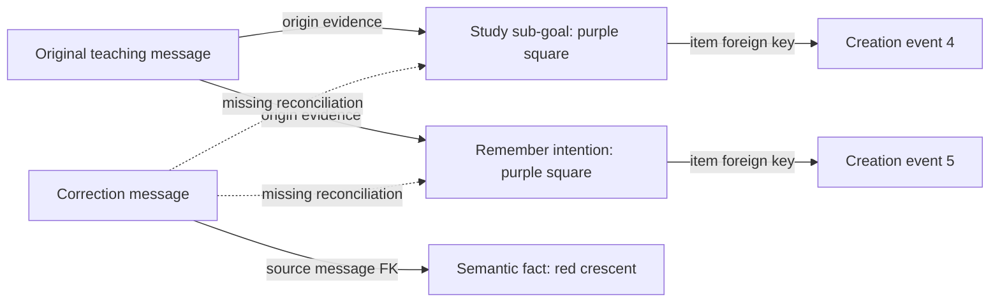

# Existing memory links: correction trace

October 20, 2026. Read-only application/database investigation of the isolated Memory Lab user. No application code, memory rows or database schema were changed. Two new JSON exports accompany this report.

## Finding

The existing relationships preserve enough provenance to find affected candidate records in this example. The missing behavior is correction reconciliation across stores. This investigation does not measure recall with versus without links and provides no basis for switching databases or adding another graph.

## Actual records and relationships

The original user message is `ba965433-cf2a-450c-99bd-80b61fddd826`, conversation sequence 3. It introduces velvet otter as a purple square and flags it for a later test.

Three working items have origin evidence pointing to that message:

| Item | Meaning | Current state |
|---|---|---|
| `befb2024-cbf1-4385-8d67-99bc7f053f4b` | Broad goal to remember the study notes | Active, revision 1; no marker embedded |
| `461a0f4e-7afe-4cbf-b4cb-f02ea6b73972` | Study sub-goal containing velvet otter = purple square | Active, revision 1; stale marker |
| `76232441-7f68-4828-a7f3-15920c6c0ac5` | Remember intention containing velvet otter = purple square | Active, revision 1; stale marker |

Their creation events are events 1, 4 and 5, respectively, connected by `memory_events.item_id`. The two stale-value events have no direct evidence rows themselves; their item foreign keys provide the route back to the original message.

The correction is user message `790557b4-a4d0-453a-a65c-e57b1483a670`, sequence 15: “I changed the velvet otter marker from a purple square to a red crescent.”

The corrected semantic fact is `aade284c-43a8-4a8d-9121-05fadfa02e84`, normalized key `fact:technical_representation_card:velvet_otter`. Its content says red crescent. Its source-message foreign key points directly to sequence 15. It is active, revision 1, evidence count 1: it was inserted as a new semantic fact, rather than revising an existing purple-square semantic fact.

No `memory_evidence` row points from the correction message to any working item or event. There are zero correction-role evidence rows for this user. The fact's supporting/contradicting episode arrays are both empty.

Arrows illustrate existing joins in either direction; the actual FK columns live on the evidence, event and semantic-fact rows. The dotted arrows are missing application behavior, not a proposal for a new graph database.

## Read-only traversal performed

1. Start from the known correction message, with ownership enforced.
2. Search earlier user messages in that same conversation for the explicit subject “velvet otter” and replaced value “purple square”. This case-specific phrase match identifies sequence 3. It is candidate discovery, not a production correction detector or proof of semantic equivalence.
3. Reverse-query `memory_evidence.message_id` for sequence 3. This reaches all three working items above through existing indexed foreign keys.
4. Query `memory_events.item_id` for those item IDs. This reaches events 1, 4 and 5.
5. Compare the candidate item contents with the correction. Two contain the replaced marker; the broader goal does not.

This succeeds without a new schema or graph. It also shows why source sharing alone must not trigger automatic rewriting: a single message may support multiple unrelated claims. Evidence identifies candidates; a validated subject/property/value correction must determine which parts actually change.

## Where the production path stops

### 1. Semantic consolidation updates only its own store

`backend/app/services/long_term_memory.py:207` extracts candidates, finds an existing semantic fact by user and normalized key, then inserts/updates content and source metadata through line 253. It does not query `MemoryEvidence` or `WorkingItem`, schedule dependent-record review, or call the memory manager to reconcile working items.

The semantic source pointer is overwritten on subsequent upserts. It is useful provenance but is not a multi-source dependency ledger. In this case there was no previous semantic row to traverse: the older value lived in working items/events.

### 2. Working-memory tools cannot revise item content

`backend/app/ai/tools/memory/tools.py:64` exposes `update_item(item, status, reason)`. It calls `memory_manager.resolve`, which changes lifecycle/status. It cannot change the text to red crescent. Available tools could drop and recreate an intention, but there is no dedicated content-revision operation or general reconciliation transaction.

`backend/app/services/memory_manager.py:423` can add owner-checked evidence links, and the schema already permits role `correction`. A search of application code found no caller that writes that correction role. Having the role available is different from maintaining consistency with it.

### 3. Background manager checks concern lifecycle

`backend/app/services/memory_manager.py:793` handles due intentions, overdue commitments and idle contexts. It does not compare corrected semantic facts against dependent working items. The mind worker invokes observations and these manager checks; that does not add a semantic reconciliation pass.

### 4. Observation capture retains the source, but does not reconcile it

Observation 16 points to the correction message and records routine message metadata. The registry intentionally skips ordinary messages with “kept in the conversation history” (`backend/app/ai/observe/registry.py:248`). `observation_memory._apply` returns on that skip. It neither reads the correction sentence nor creates correction evidence for the two stale working items.

### 5. Recall relationships already have concrete uses

- `recall_references.prior_references` follows the previous answer's referenced memories, or uncertain supplied candidates; `recall.search` re-reads those target records. Changes to the same target are therefore observable. A new fact ID does not automatically replace a different stale working-item ID.
- `recall._choose` uses an event's item link to suppress item-echo events when the item is in its ranked candidate set. This is a real existing relationship-based deduplication behavior; it is not contradiction reconciliation.
- `recall._with_evidence` reads item/event evidence and semantic source pointers to expose provenance. It does not reverse-traverse the source into other targets or apply corrections.
- Supplied/referenced reply receipts supported the E2E diagnosis. They connect answers to memories; co-supply does not establish that one memory depends on another or that two texts assert the same fact.

### 6. There is another existing correction representation, but it was inactive here

`CognitiveDialogueInterpretation` can store validated corrections as replaced/replacement user-message spans. `dialogue_memory_v0/interpreted.py:17` folds those records and marks replaced spans superseded. It does not update semantic facts or working items.

The local `cognitive_dialogue_interpretation_enabled` setting was false, and the test user has zero such records. Thus this run cannot show whether those interpreted links would improve candidate resolution. If enabled and validated, their original span/message IDs could provide a stronger seed than a phrase search, while the existing evidence links identify dependent candidate memories.

## Smallest next implementation to evaluate

A correction-aware operation in the existing memory manager is the appropriate next candidate, subject to tests:

1. Validate an explicit correction's subject, property, old value, new value and source spans. Use existing interpreted correction spans when available; otherwise do not assume a correction edge already exists.
2. Resolve old source messages; reverse-query current evidence links and follow event/item and parent relationships to collect a bounded, user-scoped candidate set.
3. Validate each affected assertion. A broad study goal remains open; only the embedded marker in the two affected items should change. Do not propagate changes blindly to every record sharing a source or parent.
4. Revise affected current item text under row locks/revision checks; link the correcting message using the existing correction evidence role; append an appropriately linked change event. Tie scheduling/retries to the successful semantic write so asynchronous job order cannot leave reconciliation permanently missed.
5. Keep original events as historical records. At recall time use their existing item links and the latest item/correction evidence to distinguish historical values from current ones. Do not rewrite old messages or erase historical events.
6. Compare the current behavior with reconciliation enabled on this fixture and broader correction scenarios: exact two-item changes, broader goal preserved, historical purple-square event retained, idempotent retry, owner isolation, and fresh-chat recall of the current value. This comparison would evaluate the added reconciliation behavior, not establish a general graph benefit.

No additional database is needed to perform the demonstrated candidate traversal. Full automatic reconciliation is not already implemented merely because the provenance links exist.

## Evidence timing clarification

The initial E2E export captured receipt 10 before all asynchronous association writes were visible. A later database check found receipt 10 has three referenced spans and status `done`; five other receipts remain `ambiguous`. The earlier report's “no referenced spans” statement was a snapshot limitation, not a final property of the run. The original JSON export is retained as that snapshot; this investigation records the later state.

## Files

- `memory-links-trace-2026-10-20.json`: actual correction, fact, items, events, origin evidence and receipts.
- `memory-links-candidates-2026-10-20.json`: read-only reverse-source traversal and reachable candidates.
